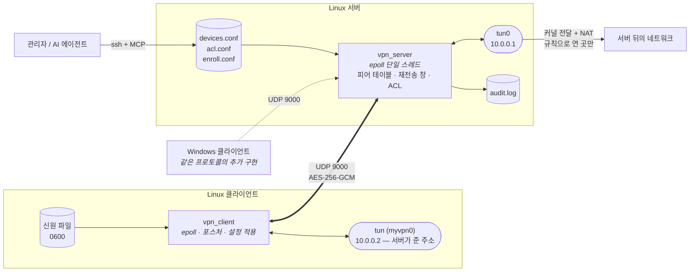
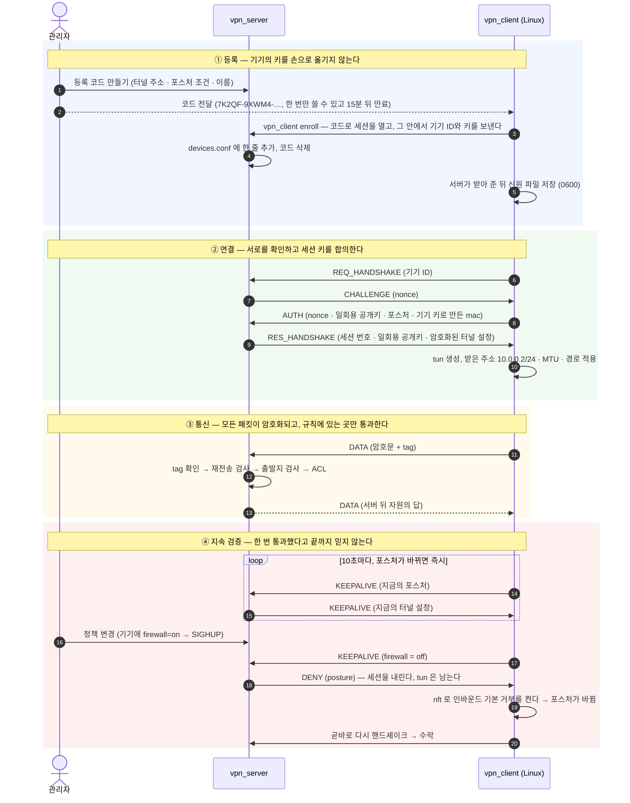

<div align="center">

# my_vpn

**Linux에서 C로 설계한 L3 VPN + ZTNA 접근 제어**

등록된 기기만 들어오고, 들어온 뒤에도 계속 확인하고, 허락한 곳에만 닿는다.

[](https://github.com/k1msatgat/my_vpn/actions/workflows/ci.yml)


[한눈에 보기](#한눈에-보기) · [서버 구조](#서버-구조) · [프로토콜](#프로토콜) · [보안 모델](#보안-모델) · [표준 프로토콜과의 대조](#표준-프로토콜과의-대조) · [빠른 시작](#빠른-시작) · [현재 한계](#현재-한계)

</div>

---

외부 VPN 라이브러리 없이 **패킷 포맷, 핸드셰이크, 세션 암호화, 접근 제어**를 직접 설계하고 구현한 L3 VPN입니다.
Linux의 TUN 디바이스로 IP 패킷을 가로채 UDP로 터널링하는 데서 시작해, ZTNA 제품이 하는 일(기기 인증, 단말 상태 확인, 정책 기반 접근 제어)을 한 단계씩 쌓았습니다.
서버와 클라이언트 모두 Linux에서 C로 돌고, 같은 프로토콜을 쓰는 Windows 클라이언트가 따로 있습니다.

| | 전통적인 VPN | 이 프로젝트 |
|---|---|---|
| 누가 들어오는가 | 비밀번호나 인증서를 가진 사람 | **등록된 기기**. 기기마다 다른 키로 서버의 물음에 답해야 한다 |
| 한 번 들어오면 | 세션이 끝날 때까지 믿는다 | **10초마다 다시 본다.** 방화벽을 끄면 세션 중에도 끊긴다 |
| 어디까지 가는가 | 내부망 전체 | **적어서 연 곳만.** 규칙이 없으면 터널 대역 밖으로 나가지 못한다 |
| 설정은 누가 갖는가 | 클라이언트의 설정 파일 | **서버.** 터널 주소와 경로를 서버가 내려 주고, 정책을 고치면 붙어 있는 기기가 따라온다 |

> 학습 목적의 프로젝트입니다. 암호 프로토콜은 외부 검토를 받은 적이 없고, 프로덕션에서 쓰기 위한 보안 수준이 아닙니다. 무엇을 어떻게 확인했는지는 항목마다 적었습니다 — [테스트](#테스트), [현재 한계](#현재-한계).

## 한눈에 보기



| 조각 | 어디서 도는가 | 하는 일 |
|---|---|---|
| **`vpn_server`** | Linux, root | 기기를 인증하고, 세션마다 키를 합의하고, 패킷마다 ACL에 대 본 뒤 tun에 쓴다. epoll 단일 스레드 |
| **`vpn_client`** | Linux, root | 등록 코드로 기기를 올리고, 인증 핸드셰이크 뒤에 tun을 만들어 서버가 준 주소·MTU·경로를 넣는다. 10초마다 포스처(커널 버전, nftables 방화벽)를 다시 보고한다 |
| **MCP 서버 / `my_vpn_ctl`** | Linux | 관리자(또는 AI 에이전트)가 서버를 올리고 내리고, 등록 코드를 만들고, 정책을 바꾸고, 감사 로그를 본다 |
| **`tools/loadgen`** | Linux | 서버 데이터 경로의 부하 생성기. 클라이언트와 같은 프로토콜 코드를 쓴다 |
| Windows 클라이언트 | Windows | 같은 프로토콜의 추가 구현 — 서비스 + GUI. [아래](#windows-클라이언트)와 [windows/README.md](windows/README.md) |

## 기기 하나가 붙기까지



이 흐름(①~④)은 `test/linux_e2e.sh`가 netns 두 개에서 그대로 재현하고 CI에서 매 푸시마다 돕니다. ④의 거절은 SIGHUP 뒤 10초(keepalive 주기) 안에, 복구는 nft 규칙을 넣고 1~2초(포스처를 읽는 주기) 안에 일어났습니다.

1. **등록.** 관리자가 일회용 코드를 만들어 건넵니다. 기기는 그 코드로 서버와 암호화된 세션을 열고, 자기가 만든 ID와 키를 그 안에서 보냅니다.
2. **연결.** 기기는 서버가 방금 뽑은 nonce에 자기 키로 서명해 "내가 그 기기"임을 보이고, 양쪽은 이번에만 쓰는 ECDH 키로 세션 키를 합의합니다. 세션 키에는 기기 키가 섞여 있어서, 서버인 척하는 쪽은 클라이언트가 받아들일 답을 만들지 못합니다.
3. **설정.** 터널 주소와 "어디를 터널로 보낼 것인가"는 서버가 수락에 실어 줍니다. 클라이언트에는 서버 주소만 적습니다.
4. **통신.** 세션의 모든 패킷은 AES-256-GCM으로 감싸입니다. 서버는 tag가 맞는 패킷만 열고, ACL이 허용한 목적지로 갈 때만 tun에 씁니다.
5. **지속 검증.** 기기는 10초마다 지금의 포스처를 다시 보고합니다. 정책에 못 미치면 서버가 세션을 내립니다. 관리자가 정책을 고치면 붙어 있는 기기의 경로가 다음 보고 주기에 따라 바뀝니다.

## 서버 구조


| 부분 | 설계 | 어디 |
|---|---|---|
| **이벤트 루프** | epoll 하나에 UDP 소켓, tun, 상태 소켓을 건다. 스레드 하나라 세션 표와 정책에 잠금이 없다. 1초 타임아웃으로 깨어 세션 만료와 `SIGHUP` 다시 읽기를 처리한다 (시그널 핸들러는 플래그만 세운다) | `server.c` |
| **피어 테이블** | 32bit 세션 번호 = 상위 24bit 난수(`getrandom`) + 하위 8bit 자리 번호. 받은 패킷의 세션은 **배열 인덱싱 한 번**으로 찾고, 번호 전체를 비교해 같은 자리를 다시 쓴 뒤의 옛 번호는 무효다. `MAX_PEERS`(8) ≤ 2^8 은 `_Static_assert` 로 강제. 송신 쪽(tun → UDP)은 inner 목적지 주소로 찾는다 | `peer.c` |
| **재전송 창** | 세션 패킷의 64bit `counter` 가 GCM nonce 이자 순번이다. 받아들인 가장 큰 값과 그 아래 64개를 비트맵으로 기억해, 순서가 바뀐 패킷은 받고 같은 값은 버린다. 포스처 보고(keepalive)만은 순서대로만 받는다 | `secure.c`, `server.c` |
| **ACL** | `src / dst / proto / dport`, 위에서부터 첫 일치, 일치하는 규칙이 없으면 거부. 규칙마다 포스처 조건을 붙일 수 있다. **상태를 추적하지 않는다** (conntrack 없음) — 클라이언트가 보낸 방향에만 걸린다 | `alc.c`, `policy.c` |
| **시계** | 세션 만료, nonce 수명은 `CLOCK_MONOTONIC` — 시스템 시간을 바꿔도 세션이 한꺼번에 만료되지 않는다 | `peer.c`, `server.c` |
| **무중단 정책 변경** | `SIGHUP` 으로 기기 목록, ACL, 등록 대기 목록을 임시 표에 읽어 검사가 끝난 뒤에만 바꿔 끼운다. 파일이 깨져 있으면 이전 것을 그대로 쓴다. 열린 세션은 다음 패킷 / 다음 keepalive 부터 새 정책을 따른다 | `server.c`, `device.c`, `alc.c` |
| **관측** | 읽기 전용 상태 소켓(세션, 포스처, 사유별 거절 수 — JSON), 감사 로그(세션의 시작과 끝, 거절, 목적지별 접근) | `status.c`, `audit.c` |

**열리지 않은 패킷은 세션의 어떤 상태도 바꾸지 못합니다.** 재전송 창에 표시하는 것, 클라이언트의 외부 주소를 갱신하는 것(NAT 뒤에서 포트가 바뀌는 경우), 세션을 내리는 것 모두 tag를 확인한 뒤에 합니다. 위조 패킷 하나로 남의 세션을 끊거나 주소를 돌려놓을 수 없습니다.

| 파일 | 관리자가 고치는 것 | 서버가 하는 일 |
|---|---|---|
| `devices.conf` | 기기 ID, 키, 터널 주소, 포스처 조건 | 여기 있는 기기만 받는다. 등록 코드로 온 기기는 서버가 직접 한 줄을 더한다 |
| `acl.conf` | 누가 어디로 갈 수 있는가 (+ 규칙별 포스처 조건) | 패킷마다 대 보고, `allow`의 목적지 대역을 그 기기의 경로로 내려 준다 |
| `enroll.conf` | (관리 도구가 관리) 발급한 등록 코드에서 뽑은 임시 신원 | 그 코드로 온 기기를 받고, 쓰인 줄을 지운다 |
| `audit.log` | — | 세션의 시작과 끝, 거절, 목적지별 접근, 정책 변경을 한 줄씩 남긴다 |

### Linux 클라이언트

| 부분 | 설계 | 어디 |
|---|---|---|
| **프로토콜** | 핸드셰이크, 등록, 세션 송신을 `session.c` 하나에 둔다. 부하 생성기도 같은 코드를 쓴다. 서버에 `connect()` 한 UDP 소켓이라 서버가 아닌 곳에서 온 패킷은 커널이 거른다 | `client/src/session.c` |
| **루프** | 서버와 같은 epoll 루프. tun → 감싸기 → send, recv → 열기 → 종류별 분기. keepalive 10초, 포스처 2초마다 읽기, 서버가 30초 조용하면 재핸드셰이크 | `client/src/client.c` |
| **신원** | `id key` 한 줄, 0600, 내 소유가 아니거나 권한이 넓으면 읽지 않는다. 임시 파일에 쓰고 fsync 한 뒤 rename | `client/src/identity.c` |
| **포스처** | 커널 버전(`LINUX_VERSION_CODE` 모양), nftables 의 인바운드 기본 거부 또는 firewalld. 백신 칸은 Linux 에 대응하는 것이 없어 "모름" | `client/src/posture.c` |
| **설정 적용** | 서버가 준 주소·prefix·MTU·경로를 ioctl 로 넣는다. 바뀐 부분만 고치고, `/0` 과 서버 주소를 덮는 경로는 넣지 않는다 | `client/src/netcfg.c` |

### 함께 쓰는 코드

`lib/common`은 Linux 서버, Linux 클라이언트, Windows 클라이언트가 **같은 소스를 빌드**합니다.

| 파일 | 내용 |
|---|---|
| `proto.{h,c}` | 와이어 헤더, 메시지 종류, 포스처 보고와 터널 설정의 직렬화 |
| `secure.{h,c}` | 세션 키 유도, 패킷 감싸기 / 풀기, 재전송 창, 등록 코드에서 임시 신원 뽑기, selftest 벡터 |
| `crypt.h` | 암호 도구의 선언. Linux 쪽은 OpenSSL(`crypt_openssl.c`), Windows는 CNG(`windows/core/crypt.c`)가 채운다 |

OS별로 갈라지는 것은 알고리즘 호출뿐이고, 양쪽 `selftest`가 같은 표준 벡터(FIPS 180-4, RFC 4231, RFC 5869, GCM 명세, RFC 5903)를 통과하는 것이 서로 통한다는 근거입니다.

## 프로토콜

### 패킷의 모양

모든 UDP 페이로드는 `msg_header`로 시작합니다. 세션이 열린 뒤의 패킷은 종류와 관계없이 같은 모양입니다.

```
 0        1        2                 4                                   8
 +--------+--------+-----------------+-----------------------------------+
 | version|  type  |    reserved     |         session_idx (BE)          |  msg_header  (8B)  ┐ 암호화하지 않지만
 +--------+--------+-----------------+-----------------------------------+                    │ tag 가 함께 덮는다
 |                         counter (BE, 64bit)                           |  data_header (8B)  ┘
 +-----------------------------------------------------------------------+
 |                  암호문 (AES-256-GCM) ...                             |
 +-----------------------------------------------------------------------+
 |                         tag (16B)                                     |
 +-----------------------------------------------------------------------+
```

터널 오버헤드는 바깥 IPv4(20) + UDP(8) + 헤더(16) + tag(16) = **60바이트**이고, 그래서 터널 MTU 기본값이 1400입니다.

| type | 값 | 내용 |
|---|---|---|
| `REQ_HANDSHAKE` | 1 | 기기 ID (16B) |
| `RES_HANDSHAKE` | 2 | 세션 번호(헤더) + 서버의 일회용 공개키 (64B) + 암호화된 터널 설정 + tag |
| `DATA` | 3 | 세션 패킷. 암호문 = inner IPv4 패킷 |
| `KEEPALIVE` | 4 | 세션 패킷. C→S: 포스처 (8B) / S→C: 지금의 터널 설정 |
| `CHALLENGE` | 5 | nonce (16B) |
| `AUTH` | 6 | 기기 ID + nonce + 클라이언트의 일회용 공개키 (64B) + 포스처 (8B) + mac (32B) |
| `DENY` | 7 | 핸드셰이크 중: 사유 (1B) + mac (32B) / 세션 중: 세션 패킷, 암호문 = 사유 |
| `ENROLL` | 8 | 세션 패킷, 등록 코드로 연 세션에서만. C→S: 기기 ID + 키 / S→C: 결과 (1B) |

### 세션 키

```
secret = ECDH(이번 핸드셰이크의 일회용 P-256 키 쌍)
prk    = HKDF-Extract(salt = 기기 키, ikm = secret)
keys   = HKDF-Expand(prk, "my_vpn v4 session" | SHA-256(AUTH 패킷 | RES 의 헤더와 pub_s), 96B)
       = C→S 키 | S→C 키 | RES_HANDSHAKE 키
nonce  = 0x00000000 | counter (8B)            패킷마다, 방향마다 다른 키
```

| 세션 키에 들어가는 것 | 그래서 |
|---|---|
| **기기 키** | 그 키를 모르는 쪽은 사이에 끼어 자기 일회용 키를 내밀어도 같은 세션 키에 닿지 못한다. 서버에 인증서를 두지 않아도 `RES_HANDSHAKE`의 tag가 맞았다는 것이 "상대가 이 기기의 키를 아는 서버"라는 증명이다 |
| **일회용 ECDH** | 기기 키가 나중에 새도 녹화해 둔 트래픽은 풀리지 않는다. 서버의 기기 목록에는 모든 기기의 키가 있어서, 이것이 없으면 서버가 한 번 뚫리는 날 지난 세션이 전부 풀린다 |
| **주고받은 패킷의 해시** | 도중에 한 바이트라도 바뀌었으면 양쪽의 키가 달라져 첫 패킷부터 열리지 않는다 |
| **방향마다 다른 키** | 양쪽이 `counter`를 0부터 세도 같은 (키, nonce)가 생기지 않고, 보낸 패킷을 되돌려 보내도 열리지 않는다 |

<details>
<summary><b>핸드셰이크의 세부</b> — 거절의 사유, 검사 순서, 방해에 대한 방어</summary>

<br/>

| 사유 | 값 | 뜻 |
|---|---|---|
| `DENY_UNKNOWN_DEVICE` | 1 | 기기 목록에 없는 ID (또는 쓸 수 없는 등록 코드) |
| `DENY_BAD_AUTH` | 2 | nonce가 다르거나 만료됐거나 mac이 틀림 |
| `DENY_TUN_IP` | 3 | (버전 3까지) 지금은 터널 IP를 서버가 내려 주므로 보내지 않음 |
| `DENY_POSTURE` | 4 | 인증은 됐지만 포스처가 그 기기의 정책에 못 미침 |

- **챌린지-응답**이라 키 자체는 와이어에 나오지 않습니다. nonce는 1회용이고 5초 뒤 만료되며, 서명이 맞는 `AUTH`를 받는 순간 버립니다.
- **확인되지 않은 패킷은 진행 중인 핸드셰이크를 건드리지 못합니다.** 살아 있는 nonce가 있는 동안 다시 온 `REQ`에는 같은 nonce를 내주고, 서명이 틀린 `AUTH`는 nonce를 버리지 않습니다. 기기 ID만 아는 제3자가 진짜 기기의 핸드셰이크를 깨뜨릴 수 없습니다.
- **검사 순서**는 기기 → nonce / mac → 포스처입니다. 키를 가졌다는 것을 확인하기 전에는 구체적인 거절 이유를 알려 주지 않고, 키 합의(비싼 계산)도 그 뒤에 합니다.
- **포스처와 일회용 공개키는 mac의 범위 안**이라 전달 도중에 "방화벽 꺼짐"을 "켜짐"으로 고치거나 공개키를 바꿔 끼울 수 없습니다.
- 클라이언트는 `AUTH`를 보내기 전에 온 수락과 **tag가 맞지 않는 수락을 받지 않습니다.**
- **거절을 믿어도 되는가.** 인증 뒤의 거절(포스처)에는 기기 키로 만든 mac이 붙습니다. 그 전의 거절은 서버가 상대의 키를 확인하지 못한 상태라 mac이 없고, 클라이언트는 이런 거절을 곧바로 믿지 않고 진짜 서버의 답을 끝까지 기다린 뒤 다른 답이 없을 때에만 받아들입니다. 세션 중의 거절은 세션 키로 감쌉니다.
- 새로 인증하면 새 세션입니다. 세션 번호도, 키도, counter도 새로 시작합니다.

</details>

<details>
<summary><b>터널 설정</b> — 서버가 주소와 경로를 내려 주는 방식</summary>

<br/>

```
tun_ip(4) | prefix_len(1) | n_routes(1) | mtu(2) | n_routes x ( addr(4) | prefix_len(1) )
```

| 값 | 어디서 오는가 |
|---|---|
| 터널 주소 | 기기 목록에 그 기기 앞으로 적힌 주소 |
| 대역의 prefix, MTU | 서버를 띄울 때의 `-n` / `-m` |
| 경로 | ACL에서 그 기기의 터널 주소가 출발지에 걸리는 `allow` 규칙들의 목적지 대역 |

- **경로는 ACL에서 뽑습니다.** 경로 목록을 따로 두면 둘이 어긋납니다 — 경로는 있는데 규칙이 없어 터널로 들어간 패킷이 버려지거나, 규칙은 있는데 경로가 없어 터널로 가지도 않습니다.
- **빼는 것**: `deny` 규칙, 터널 대역 안의 목적지, 목적지가 `any`인 규칙.
- **`RES_HANDSHAKE`와 서버의 keepalive 응답에 통째로 실립니다.** 클라이언트는 받은 것과 지금 적용한 것을 비교하기만 하면 됩니다.
- **클라이언트는 달라진 부분만 고칩니다.** 터널 주소가 바뀐 경우만 다시 핸드셰이크합니다.
- **클라이언트는 받은 경로를 그대로 믿지 않습니다.** `/0`과 서버 자신의 주소를 덮는 대역은 넣지 않습니다.

</details>

<details>
<summary><b>등록 코드</b> — 새 핸드셰이크를 만들지 않은 이유</summary>

<br/>

```
id  = HMAC-SHA256("my_vpn enroll id",  코드) 의 앞 16B     서버가 코드를 찾는 이름표
key = HMAC-SHA256("my_vpn enroll key", 코드)               코드를 아는 쪽만 만드는 비밀
```

코드에서 임시 신원을 뽑아 **평소의 핸드셰이크를 그대로 돕니다.** 코드를 모르는 쪽은 세션을 열지 못하고, 서버인 척하는 쪽은 수락을 만들지 못하고, 기기의 진짜 키는 그 세션의 키로 감싸여 가므로 코드를 나중에 알게 된 사람도 녹화해 둔 등록에서 키를 꺼내지 못합니다. 새로 생긴 것은 `ENROLL` 메시지 하나입니다.

- 코드는 0-9와 헷갈리는 글자(I L O U)를 뺀 대문자 25자, 125비트입니다.
- **한 번 쓰면 지워지고, 쓰지 않아도 만료됩니다.** (`linux_e2e.sh`가 같은 코드의 두 번째 사용이 거절되는 것을 확인)
- **등록용 세션으로는 등록 말고 아무것도 하지 못합니다.**
- **기기가 정할 수 있는 것은 자기 신원뿐입니다.** 터널 주소, 포스처 조건, 이름은 관리자가 코드를 만들 때 정한 것이 그대로 적힙니다.
- 기기는 **서버가 받아 준 뒤에** 신원을 저장합니다.

</details>

<details>
<summary><b>keepalive와 세션의 수명</b></summary>

<br/>

| 상수 (`proto.h`) | 값 | 의미 |
|---|---|---|
| `KEEPALIVE_INTERVAL_SEC` | 10 | 클라이언트의 keepalive(포스처 보고) 주기 |
| `SERVER_TIMEOUT_SEC` | 30 | 클라이언트가 이 시간 동안 서버에서 아무것도 받지 못하면 재핸드셰이크 |
| `SESSION_TIMEOUT_SEC` | 60 | 서버가 이 시간 동안 수신이 없는 세션을 만료 |

- keepalive는 NAT 매핑 유지, 생존 확인, **포스처 재보고**, **터널 설정 갱신**을 겸합니다.
- **데이터는 순서가 바뀌어도 받고, 포스처 보고는 순서대로만 받습니다.** 보고는 "지금의 상태"라서, 방화벽이 켜져 있던 때의 보고를 붙잡아 두었다가 끈 뒤에 풀어 놓는 것을 막아야 합니다.
- 거절된 클라이언트는 터널을 닫지 않고 통과만 막은 채, 포스처가 바뀌면 바로, 그렇지 않아도 30초마다 다시 핸드셰이크합니다.
- 서버는 세션이 마지막으로 보고한 포스처로 ACL 규칙의 포스처 조건을 판정합니다. 기기 정책은 통과하지만 규칙의 조건에는 못 미치면 세션은 유지되고 그 목적지만 닫힙니다.

</details>

<details>
<summary><b>패킷이 지나는 길</b> — 송신, 수신, 검증 순서</summary>

<br/>

**서버의 송신 (TUN → UDP).** 버퍼의 앞 16바이트(헤더)와 뒤 16바이트(tag) 자리를 남기고 읽은 뒤, 읽은 자리에서 암호화합니다. 패킷을 옮기지 않습니다.

```
read(tun, buf + 16)     [ ........ 16B ........ ][ IP packet (n) ][ ... 16B ... ]
secure_seal(buf, n)     [ msg_hdr ][ counter   ][   암호문 (n)   ][    tag     ]
sendto(buf, n + 32)     └────────────────── 한 번에 전송 ──────────────────────┘
```

**서버의 수신 (UDP → TUN).**

1. 헤더 길이 / 프로토콜 버전
2. `REQ_HANDSHAKE` / `AUTH`면 핸드셰이크로
3. 세션 번호로 세션 조회
4. **세션 키로 열기** — tag가 맞지 않거나 이미 받은 `counter`면 여기서 버린다
5. 등록용 세션이면 `ENROLL`만 받는다
6. 종류별 분기 (keepalive → 포스처 재평가)
7. IPv4 형식 검사
8. inner 출발지가 그 세션의 터널 주소인가
9. ACL (규칙 파일이 없으면 터널 대역 안인가) — 결과를 감사 로그에
10. 모두 통과한 뒤에만 외부 주소와 `last_seen` 갱신, tun에 쓴다

**클라이언트의 수신.** 출발지가 서버인가(Linux 는 `connect()` 로 커널이 거른다) → 헤더 / 버전 → 내 세션 번호인가 → 세션 키로 열기 → 종류별 분기. "서버가 살아 있다"는 표시도 tag를 확인한 뒤에 합니다.

</details>

## 보안 모델

무엇을 막고, 무엇을 아직 막지 못하는지 적습니다. 마지막 열은 그것을 무엇으로 확인했는지입니다.

| 위협 | 상태 | 어떻게 | 확인 |
|---|---|---|---|
| 등록되지 않은 기기의 접속 | ✅ | 기기 목록에 있는 기기가 자기 키로 서버의 nonce에 서명해야 세션을 받는다 | auth_check |
| 도청 | ✅ | 세션의 모든 패킷을 AES-256-GCM으로 암호화. 일회용 ECDH라 기기 키가 나중에 새도 지난 세션은 풀리지 않는다 | auth_check (서버의 세션 패킷을 독립 구현으로 열어 본다). 와이어에 평문이 없는지는 캡처로 볼 것 (실험 1) |
| 패킷 주입 / 변조 | ✅ | 세션 키로 만든 tag가 맞아야 받는다. 헤더(종류, 세션 번호, `counter`)도 tag의 범위 안 | auth_check |
| 재전송 | ✅ | `AUTH`는 1회용 nonce, 세션 패킷은 64개 폭의 창, 포스처 보고는 순서대로만 | auth_check |
| 서버 위장 | ✅ | 세션 키에 기기 키가 들어가므로 그 키를 모르는 쪽은 클라이언트가 받아들일 수락을 만들지 못한다 | 코드 검토 (클라이언트 쪽 자동 시험 없음) |
| 위조 패킷으로 남의 세션 끊기 / 주소 돌리기 | ✅ | 세션 키로 열린 패킷만 세션의 상태를 바꾼다 | auth_check |
| 핸드셰이크 방해 | ✅ | 살아 있는 nonce는 덮어쓰지 않고, 서명이 틀린 `AUTH`는 nonce를 버리지 않는다 | auth_check |
| 세션 안에서 출발지 주소 위조 | ✅ | inner 출발지가 그 세션의 터널 주소와 다르면 버린다 | auth_check |
| 정책 밖 목적지 접근 | ✅ | ACL 기본 거부. 규칙 파일이 없으면 터널 대역 안까지만 | auth_check, linux_e2e |
| 정책에 못 미치는 단말 | ✅ | 핸드셰이크와 매 keepalive에서 기기별 포스처 정책 평가, ACL 규칙별 포스처 조건 | auth_check, linux_e2e |
| 분실 / 폐기된 기기 | ✅ | 목록에서 지우면 다음 keepalive(10초 이내)에서 차단 | auth_check |
| 등록할 때 키가 새는 것 | ✅ | 기기의 키는 등록 코드로 연 세션의 키로 감싸여 간다. 코드는 일회용이고 만료된다 | auth_check, linux_e2e |
| 가짜 거절로 접속 방해 | ⚠️ | 인증 뒤의 거절은 확인한다. 인증 전의 거절은 확인할 수 없어 진짜 답을 끝까지 기다린다. 경로 위에서 패킷을 지울 수 있는 공격자는 여전히 막을 수 있다 | 코드 검토 |
| 가로챈 등록 코드 | ❌ | 만료 전의 코드를 가진 사람이 그 자리의 기기가 된다. 누가 올라왔는지는 감사 로그에 남는다 | — |
| 메타데이터 노출 | ❌ | 기기 ID와 핸드셰이크의 포스처는 평문이다. 누가 언제 얼마나 주고받는지 보인다 | — |
| 포스처 거짓 보고 | ❌ | 포스처는 클라이언트의 자기 보고다. 키를 가진 변조된 클라이언트는 거짓으로 보고할 수 있다 (막으려면 TPM 기반 원격 증명이 필요) | — |

## 표준 프로토콜과의 대조

같은 문제를 표준은 어떻게 푸는지, 이 프로젝트는 무엇을 단순화했고 그래서 어디가 약한지 적습니다.

> 실험 8(같은 서버에 WireGuard 를 올려 핸드셰이크를 나란히 캡처)의 결과로 이 절을 보강할 예정입니다. 지금 내용은 설계와 명세를 비교한 것입니다.

### 핸드셰이크 ↔ IKEv2

| | IKEv2 (RFC 7296) | 이 프로젝트 |
|---|---|---|
| 메시지 | 2왕복: `IKE_SA_INIT`(DH 공개값, nonce, 알고리즘 제안) → `IKE_AUTH`(암호화된 신원과 인증) | 2왕복: `REQ`(기기 ID) → `CHALLENGE`(nonce) → `AUTH`(공개값, 포스처, mac) → `RES`(공개값, 암호화된 설정) |
| 인증 | 인증서, PSK, EAP | 기기별 256bit 대칭 키(PSK 와 같은 성격)로 만든 HMAC |
| 키 합의 | 일회용 DH → PRF+ 로 IKE SA 키, 그 위에 Child SA 키 | 일회용 ECDH P-256 → HKDF(salt = 기기 키) 로 방향별 키 셋 |
| 알고리즘 | 제안과 선택 (협상) | 고정 (P-256, HKDF-SHA256, AES-256-GCM) |
| DoS | 응답자가 부하를 받으면 `COOKIE` 로 출발지 주소부터 확인 | 비싼 계산(ECDH)은 mac 을 확인한 뒤에만. 쿠키 같은 출발지 확인은 없다 |
| 재키잉 | `CREATE_CHILD_SA` 로 세션 중에 키 교체 | 없음. 다시 핸드셰이크할 때만 키가 바뀐다 |

- **같은 점**: 일회용 DH 로 전방 비밀성을 얻고, 주고받은 메시지를 키 유도(또는 서명)에 묶어 중간 변조를 잡는다. 확인 전에는 비싼 일을 하지 않는다.
- **단순화**: 협상이 없어 메시지가 짧고 다운그레이드 공격면이 없지만, 알고리즘을 바꾸려면 프로토콜 버전을 올려야 한다. 신원을 암호화하지 않는다 — IKEv2 는 `IKE_AUTH` 에서 신원을 이미 합의한 키로 감싼다.
- **그래서 약한 곳**: 기기 ID 와 포스처가 평문이라 수동 관찰자가 기기를 추적하고 단말 상태를 엿볼 수 있다. 출발지를 위조한 `REQ`(24B) 로 다른 주소에 답을 보내게 할 수 있다 — 등록된 기기 ID 면 `CHALLENGE`(24B, 증폭 없음), 모르는 ID 면 `DENY`(41B, 약 1.7배). 재키잉이 없어 한 세션 키가 오래 쓰인다.

### 데이터 패킷 ↔ ESP

| | ESP (RFC 4303, GCM 은 RFC 4106) | 이 프로젝트 |
|---|---|---|
| 식별 | SPI (32bit) | `session_idx` (32bit, 하위 8bit 가 테이블 자리) |
| 순번 | Sequence Number 32bit, ESN 이면 64bit 중 하위 32bit 만 와이어에 | `counter` 64bit 를 와이어에 전부 |
| nonce | salt(4B, 키에서) + 명시적 IV(8B, 패킷에) | `0x00000000` + `counter`. IV 를 따로 싣지 않는다 (RFC 8750 의 암묵적 IV 와 같은 생각) |
| 인증 범위 | ESP 헤더(SPI, 순번) + 암호문 | 헤더(버전, 종류, 세션 번호) + `counter` + 암호문 |
| 패딩 / 다음 헤더 | 있음 (전송 / 터널 모드, 트래픽 흐름 은닉용 패딩) | 없음. 터널 모드 IPv4 만 |
| 전송 | IP 프로토콜 50, NAT 뒤에서는 UDP 4500 캡슐화 | 처음부터 UDP |

- **같은 점**: SPI 로 SA 를 찾듯 세션 번호로 세션을 찾고, 순번이 곧 재전송 방지 수단이며, AEAD 하나로 암호화와 무결성을 함께 얻는다.
- **단순화**: 순번을 64bit 그대로 실어 ESN 의 상위 비트 추정이 필요 없다(대신 패킷마다 4바이트 더). salt 가 없어 nonce 가 `counter` 만으로 정해지므로, 방향마다 키를 달리하는 것으로 (키, nonce) 중복을 막는다.
- **그래서 약한 곳**: 패딩이 없어 암호문 길이가 평문 길이를 그대로 드러낸다. 프로토콜 번호 대신 UDP 라 NAT 를 쉽게 지나지만, 방화벽이 "VPN 트래픽"으로 알아보는 표시도 없다.

### 재전송 창 ↔ ESP 시퀀스 윈도우

| | ESP (RFC 4303 §3.4.3) | 이 프로젝트 |
|---|---|---|
| 창 | 최소 32, 기본 64 를 권고. 받은 가장 큰 순번 아래를 비트맵으로 | 64. 같은 방식 (`secure.c`, 가장 큰 값 + 비트맵) |
| 순서가 바뀐 패킷 | 창 안이면 받는다 | 같다 |
| 실패한 패킷 | 무결성 확인을 통과한 뒤에만 창을 갱신 | 같다 — tag 가 맞은 뒤에만 표시한다 |
| 포스처 보고 | — | 창과 별도로 "직전보다 커야 한다"(엄격한 순서) |

- **그래서 약한 곳**: 창이 64 라 고속 링크에서 경로가 패킷을 64개 이상 뒤섞으면 정상 패킷도 버려진다. 더 넓은 창은 메모리와 맞바꾸는 문제다.

### 키 합의 ↔ WireGuard (Noise IK)

| | WireGuard | 이 프로젝트 |
|---|---|---|
| 왕복 | 1왕복 (initiation → response) | 2왕복 (nonce 를 서버가 먼저 준다) |
| 신원 | 정적 공개키. 개시자의 공개키는 암호화돼 간다 | 기기 ID(평문) + 대칭 기기 키 |
| 재전송 방지(핸드셰이크) | TAI64N 타임스탬프 | 서버의 1회용 nonce |
| 서버가 가진 것 | 피어의 **공개키**만 | 모든 기기의 **대칭 키** |
| 거절 | 응답하지 않는다 (인증되지 않은 패킷에 침묵) | `DENY` 로 사유를 알린다 (인증 전에는 사유를 뭉뚱그림) |
| 키 교체 | 2분마다 자동 재핸드셰이크 | 없음 |
| DoS | 부하 시 쿠키 응답 (mac2) | 없음 |

- **같은 점**: 매 핸드셰이크 일회용 DH, 협상 없는 고정 암호 묶음, 세션 패킷의 카운터가 nonce 이자 재전송 창의 순번.
- **단순화**: Noise 의 정적-정적 DH 대신 대칭 기기 키를 HKDF 의 salt 로 섞는다. 서버가 nonce 를 주므로 시계에 기대지 않지만 왕복이 하나 늘어난다.
- **그래서 약한 곳**: 서버가 뚫리면 모든 기기의 키가 드러나 그 기기들로 가장할 수 있다 (WireGuard 서버가 뚫려도 피어의 개인키는 나오지 않는다). 기기 ID 가 평문이라 기기 추적이 된다. `DENY` 에 답하므로 포트 스캔에 서버의 존재가 드러난다.

## 빠른 시작

### 한 장비에서 전체 재현 (root 불필요)

```bash
make                    # gcc, OpenSSL 3 개발 헤더 (openssl-devel / libssl-dev), nftables
test/linux_e2e.sh       # netns 두 개: 등록 → 연결 → ACL 차단 → 포스처 거부와 복구
```

root 가 아니면 사용자 네임스페이스(`unshare -rn`) 안에서 돌고, 장비의 네트워크는 건드리지 않습니다.

### 장비 두 대 (Linux 서버 + Linux 클라이언트)

**서버**

```bash
make
mcp/install.sh                                  # systemd 서비스 + 관리 도구(my_vpn_ctl) 설치, Node.js 18+
sudo systemctl start my_vpn
# 서버의 UDP 9000 을 연다 (firewalld 면 firewall-cmd --add-port=9000/udp)

# 등록 코드 만들기 — 한 번만 쓸 수 있고 15분 뒤 만료
echo '{"cmd":"enroll_create","label":"laptop"}' | sudo my_vpn_ctl
```

설치하지 않고 직접 띄우려면:

```bash
sudo ./server/bin/vpn_server -e enroll.conf -a audit.log 9000 devices.conf acl.conf &
sudo ip addr add 10.0.0.1/24 dev tun0 && sudo ip link set tun0 mtu 1400 up
```

| 옵션 | 뜻 |
|---|---|
| `<port> <device-file> [acl-file]` | 듣는 포트, 기기 목록(필수), ACL(없으면 터널 대역 안까지만) |
| `-e <file>` | 등록 코드의 대기 목록 |
| `-a <file>` | 감사 로그 |
| `-s <path>` | 상태 소켓 |
| `-n <prefix>` `-m <mtu>` | 터널 대역의 prefix 길이와 MTU (기본 24, 1400). 클라이언트에 그대로 내려간다 |

**클라이언트**

```bash
make client
sudo ./client/bin/vpn_client enroll <server-ip> 9000 <등록 코드>    # 한 번
sudo ./client/bin/vpn_client run <server-ip> 9000                   # 주소·경로는 서버가 준다
ping 10.0.0.1
```

자세한 절차(실제 장비, firewalld, 기기 정책, ACL, 서버 뒤로 전달, 감사 로그)는 [docs/linux.md](docs/linux.md)에 있습니다. 위 두 장비 절차는 아직 실제 장비로 처음부터 끝까지 따라 해 보지 않았습니다 — 한 장비 재현(`linux_e2e.sh`)만 CI 에서 확인합니다.

## 테스트

| 무엇을 | 어떻게 | 어디서 |
|---|---|---|
| Linux 서버 ↔ Linux 클라이언트 | `test/linux_e2e.sh` — netns 두 개에서 등록 → 연결(서버가 준 주소·MTU·경로) → ACL 차단 → 포스처 거부와 nft 로 방화벽을 켠 뒤의 복구. 18개 | CI, 한 장비 |
| 서버의 프로토콜 | `sudo python3 test/auth_check.py` — 클라이언트인 척 UDP 패킷을 직접 만들어 보낸다. **176개.** 세션 키 유도와 패킷 형식을 서버의 코드를 거치지 않고 따로 구현했다 | CI, 한 장비 |
| 암호 도구 | `vpn_server selftest` / `vpn_client selftest` / `vpn_client.exe selftest` — 같은 표준 벡터 20개 | CI |
| 빌드 | Linux `-Wall -Wextra -Werror`, Windows `/W4` 경고 없음 | CI |
| 서버 처리량 | `tools/loadgen/bench.sh` — 아래 [성능](#성능) | CI |
| 두 장비 시나리오 | `test/server.sh` + `test/client.sh [idle\|stop\|restart]` — 유휴 중 keepalive, 클라이언트 정지 뒤 만료와 복구, 서버 재시작 복구 | 실제 장비 (v4 클라이언트로는 아직 돌려 보지 않음) |

`auth_check.py`가 보는 것: 모르는 기기와 틀린 키, `AUTH` 재전송과 만료된 nonce, 서명 뒤의 변조, 곡선 위에 없는 공개키, 핸드셰이크 방해, 포스처 정책의 경계값, 세션 패킷의 변조 / 재전송 / 다른 세션의 키, 순서가 바뀐 패킷과 창, 정책 다시 읽기, 규칙별 포스처, 터널 설정의 발급과 갱신, 규칙이 없을 때의 차단, 감사 로그, 등록 코드의 일회성과 등록용 세션의 제한.

### 성능

서버 혼자의 왕복 처리량을 부하 생성기로 잰 값입니다. 부하 생성기는 TUN 없이 UDP 소켓 하나로 핸드셰이크를 하고, 터널 안에 ICMP echo 를 실어 서버의 tun 주소로 보냅니다(서버의 udp→tun, tun→udp 두 경로를 모두 지난다).

| 페이로드 | 받은 pps | 받은 Mbps | 서버 CPU |
|---:|---:|---:|---:|
| 56 B | 약 44,000 | 30 | 90% |
| 512 B | 약 43,000–47,000 | 186–203 | 91% |
| 1372 B | 약 42,000 | 475 | 90% |

- **측정 환경**: GitHub Actions 러너 (AMD EPYC 9V74, 4 vCPU 공용 VM, 커널 6.17 azure), 루프백, 세션 하나, 서버를 CPU 0 에 고정하고 부하 생성기는 CPU 1–2. 공용 VM 이라 절대값은 흔들린다.
- 크기와 상관없이 **초당 패킷 수에서 막힌다** — 바이트가 아니라 패킷마다 드는 비용(시스템 콜, 커널 네트워크 경로)이 한계다. perf 상위도 거의 커널 함수다.
- iperf3 로 터널을 거친 TCP/UDP 처리량과 터널 없이 직결한 값을 비교하는 측정은 진행 중입니다 (docs/performance.md 예정).

## 현재 한계

- **암호 프로토콜은 외부 검토를 받은 적이 없습니다.** 알고리즘은 OpenSSL과 CNG의 것이고 조립하는 방식(사전 공유 키 + 일회용 ECDH + HKDF + AEAD)도 널리 쓰이는 구조이지만, 이 조립을 다른 사람이 분석한 적은 없습니다. 테스트가 보여 주는 것은 "의도한 대로 동작한다"까지입니다.
- **ACL 은 상태를 추적하지 않습니다.** 서버의 ACL 은 클라이언트가 보낸 패킷(UDP → tun)에만 걸리고, 연결 상태(conntrack)를 보지 않습니다. 돌아오는 방향을 막는 것은 서버의 nftables 전달 규칙(안에서 시작한 연결의 답만)에 맡깁니다. 규칙은 패킷 단위라 "이 TCP 연결은 허용됐다"는 개념이 없습니다.
- **유저 공간 단일 스레드입니다.** 패킷마다 `read`/`recvfrom` → 열기 → ACL → `write`/`sendto` 를 한 스레드가 합니다. 측정에서 패킷 수로 막히는 이유입니다. 코어를 늘려도 빨라지지 않습니다.
- **세션 키를 도중에 바꾸지 않습니다.** 키는 다시 핸드셰이크할 때에만 바뀝니다.
- **기기 키는 서버에 평문으로 있습니다.** 기기 목록 파일의 권한(600)에 기대며, 서버가 뚫리면 모든 기기의 키가 드러납니다. 공개키 방식이면 서버에는 공개키만 두면 됩니다.
- **기기 ID 와 핸드셰이크의 포스처는 평문입니다.** 기기를 추적할 수 있습니다.
- **포스처는 자기 보고입니다.** Linux 에서는 커널 버전과 nftables 만 봅니다. iptables-legacy 로 건 규칙은 보지 못하고, 백신 칸은 수집하지 않습니다.
- **기기만 인증합니다.** 그 기기를 누가 쓰고 있는지(사용자 로그인)는 보지 않습니다.
- **재핸드셰이크는 블로킹입니다.** 응답을 최대 5초 기다리는 동안 터널 패킷은 처리되지 않습니다.
- **종료 통지가 없습니다.** 클라이언트가 종료해도 서버는 알지 못하고, 세션은 60초 뒤 만료로 정리됩니다.
- **IPv4만 터널링합니다.** 멀티캐스트 / 브로드캐스트도 통과하지 못합니다.
- **ACL이 막은 패킷은 클라이언트에게 알리지 않습니다.** 사용자에게는 타임아웃으로 보입니다.
- **모든 트래픽을 터널로 보내는 구성은 없습니다.** 경로는 대역 단위이고, 도메인 이름으로 접근 대상을 정하는 방법은 없습니다.
- **ACL 규칙의 출발지는 터널 IP입니다.** 여러 기기를 역할로 묶어 쓰는 방법은 없습니다.
- **서버와 관리 도구가 같은 순간에 기기 목록을 고치는 경우를 잠그지 않았습니다.**

## Windows 클라이언트

같은 프로토콜(`lib/common`)을 쓰는 Windows 구현입니다. 터널은 시스템 서비스(`vpn_service.exe`, Wintun 가상 어댑터)가 맡고, GUI(`vpn_gui.exe`, MFC)는 권한 없이 이름 있는 파이프로 조종합니다. 기기 키는 DPAPI 로 보관하고, 포스처는 OS 빌드, Windows 방화벽, 보안 센터의 백신 상태를 봅니다. 서비스 없이 도는 콘솔 클라이언트(`vpn_client.exe`)도 있습니다.

CI 는 MSVC `/W4` 빌드와 selftest 까지 확인합니다. 실제 Windows 10 장비에서 콘솔 클라이언트와 서비스(설치, `ctl` 로 상태 / 거절 확인, 권한 없는 GUI 가 붙는 것)를 확인했고, GUI 화면에서의 조작과 재부팅 뒤 이어서 연결하는 것은 확인하지 않았습니다. 빌드, 설치, 화면은 [windows/README.md](windows/README.md)에 있습니다.

## 프로젝트 구조

```
my_vpn/
├── lib/common/                # 서버와 두 클라이언트가 함께 빌드하는 코드
│   ├── include/{proto,crypt,secure}.h
│   └── src/{proto,secure}.c, crypt_openssl.c (Linux 쪽 암호 도구, OpenSSL)
├── server/                    # Linux 서버
│   └── src/
│       ├── server.c           # epoll 루프, 핸드셰이크, 데이터 경로
│       ├── peer.c             # 세션 표, 세션 번호, 만료
│       ├── device.c           # 등록된 기기 목록, 기기별 포스처 정책
│       ├── enroll.c           # 등록 코드의 대기 목록, 기기를 목록에 올리기
│       ├── alc.c              # ACL 파싱과 매칭, 규칙별 포스처 조건, 경로 뽑기
│       ├── policy.c           # 포스처 조건의 문법과 판정
│       ├── audit.c            # 감사 로그
│       └── status.c           # 상태 소켓
├── client/                    # Linux 클라이언트
│   └── src/
│       ├── client.c           # epoll 루프, enroll / run / posture / selftest
│       ├── session.c          # 핸드셰이크, 등록, 세션 송신 (loadgen 과 함께 쓴다)
│       ├── identity.c         # 기기 신원 파일 (0600)
│       ├── posture.c          # 커널 버전, nftables 방화벽
│       └── netcfg.c           # 서버가 준 주소 · MTU · 경로를 tun 에
├── tools/loadgen/             # 서버 부하 생성기와 측정 스크립트
├── test/
│   ├── linux_e2e.sh           # Linux 서버 <-> 클라이언트 (netns 두 개)
│   ├── auth_check.py          # 서버의 프로토콜 검사
│   └── server.sh, client.sh   # 두 장비 시나리오
├── mcp/                       # 서버 관리 — MCP 서버(Node.js)와 root 헬퍼 my_vpn_ctl, systemd 유닛
├── windows/                   # Windows 클라이언트 (서비스 + GUI + 콘솔, Visual Studio 솔루션)
├── docs/{linux,experiments,mcp}.md
└── .github/workflows/ci.yml
```

## 문서

| 문서 | 내용 |
|---|---|
| **이 문서** | 전체 구조, 프로토콜, 보안 모델, 표준과의 대조 |
| [docs/linux.md](docs/linux.md) | 서버와 클라이언트의 빌드와 실행, 기기 등록, Linux 포스처, ACL, 서버 뒤로 전달, 감사 로그, 상태 소켓 |
| [docs/experiments.md](docs/experiments.md) | 직접 돌려 보고 깨뜨려 본 실험의 기록 (한 일 / 본 것 / 그 이유) |
| [docs/mcp.md](docs/mcp.md) | MCP 서버 — 설치, 연결, 도구 |
| [windows/README.md](windows/README.md) | Windows 클라이언트 — 서비스와 GUI, Wintun, 패킷 분석 화면 |

## 로드맵

<details>
<summary><b>한 것</b></summary>

<br/>

- [x] TUN 디바이스 + UDP 터널, 와이어 헤더, 핸드셰이크와 세션 번호
- [x] ACL (기본 거부), 위조 방어, keepalive와 세션 만료, 재핸드셰이크
- [x] 기기 인증과 포스처 기반 정책, 지속 검증, 리소스별 포스처 조건
- [x] 정책 무중단 변경(`SIGHUP`), 핸드셰이크 방해 방어, 상태 소켓
- [x] **세션 암호화** — 일회용 ECDH + 기기 키로 세션 키, AES-256-GCM, 재전송 창
- [x] **서버가 내려 주는 터널 설정** — 주소 / MTU / ACL에서 뽑은 경로, keepalive로 갱신
- [x] **서버 뒤의 네트워크로 전달** — 규칙으로 연 곳만, NAT, 되돌아오는 답만
- [x] **감사 로그**, **등록 코드**, MCP 서버, CI
- [x] **Linux 클라이언트 v4** — 등록, 인증, 세션 암호화, Linux 포스처, 서버 설정 적용, netns 전체 경로 시험
- [x] 서버 부하 생성기와 CI 측정
- [x] Windows 클라이언트 — Wintun, 서비스 + GUI 분리, 패킷 분석 화면

</details>

### 다음 단계

- mTLS/JWT 기반 IdP 연동 — 기기에 더해 "누가"(사용자)를 IdP 토큰으로 확인하고 ACL 에 쓴다
- XDP 기반 빠른 경로 — 헤더가 깨졌거나 모르는 세션 번호인 패킷을 커널 앞단에서 버린다

## AI 사용 내역

이 프로젝트는 학습이 목적이므로, AI(Claude Code)를 어디에 썼는지 구분해서 밝힙니다.

**검증 방식: AI로 구현하고, 직접 실행하고 패킷을 캡처·재전송·변조해 보는 실험으로 검증합니다 — [docs/experiments.md](docs/experiments.md).** 실험 기록은 진행 중이고, 지금 기록된 것은 0번(성능 측정의 해석)입니다. 자동 시험(`auth_check.py`, `linux_e2e.sh`)은 CI에서 매번 돕니다.

| 구분 | 내용 |
|---|---|
| 직접 구현 | 와이어 프로토콜, 핸드셰이크, 피어 테이블, 위조 방어, keepalive, 세션 만료, 재핸드셰이크 등 초기 클라이언트 / 서버 기능 로직. ACL의 매칭 로직과 피어 테이블의 구조. 초기 Linux 클라이언트(`client.c`) — v4 로 올리면서 epoll 루프의 골격만 남고 나머지는 AI가 다시 썼다 |
| AI 리뷰 | 위 구현의 diff를 AI에게 검토받고, 지적받은 버그는 직접 수정 |
| 방향은 직접, 구현은 AI | ZTNA로의 확장 범위와 순서, "터널을 돌리는 서비스 + 조종하는 GUI" 구조, Linux 기준으로의 재구성(Linux 클라이언트 v4, 테스트, 문서) |
| AI 구현 | 아래 목록 |

<details>
<summary><b>AI가 작성한 부분의 목록</b></summary>

<br/>

| 내용 |
|---|
| `test/` 테스트 스크립트 전체 |
| `client.c`의 재핸드셰이크 로그, `do_handshake`의 `SO_RCVTIMEO` 원복과 `tx_counter` 리셋 (일부) |
| `windows/` Windows 클라이언트 전체 — `core/tunnel.c`(Wintun 터널 루프), `core/vpn_session.c`(워커 스레드 / 메시지 마셜링), `cli/`, `gui/`, Visual Studio 프로젝트 파일. Linux 클라이언트의 프로토콜 동작을 기준으로 작성 |
| `proto.h` / `proto.c` 분리 (기존 코드 이동) |
| Windows 유휴 시 비유니캐스트 송신이 keepalive를 억제해 불필요한 재핸드셰이크가 생기는 문제를 테스트로 재현하고 `windows/` 쪽을 수정 |
| ZTNA 확장의 Windows 쪽 — `core/posture.c`, `core/device.c`, `core/tunnel.c`의 인증 핸드셰이크와 지속 검증, GUI의 포스처 탭과 기기 등록 창 |
| ZTNA 확장의 서버 쪽 — `server/src/device.c`, `server.c`의 `handle_request` / `handle_auth` / `handle_keepalive` / `send_deny`와 SIGHUP 처리, `peer.c`의 `peer_drop`, `test/auth_check.py`. 기존 서버 로직(피어 테이블, 데이터 경로, ACL)은 직접 구현한 것 그대로 |
| `proto.h` / `proto.c`의 인증 · 포스처 메시지 정의. 메시지 흐름은 AI가 제안하고 검토 후 채택 |
| 서버의 ZTNA 확장 (2차) — `policy.c`, `status.c`, `alc.c`의 다시 읽기와 규칙별 포스처 조건, `server.c`의 nonce 재사용과 상태 소켓, `peer.c`의 단조 시계와 세션별 카운터 |
| 세션 암호화 — `lib/common`의 `crypt.h` / `secure.{h,c}`, OpenSSL 구현(지금의 `lib/common/src/crypt_openssl.c`), `windows/core/crypt.c`(CNG), 핸드셰이크 / 데이터 / keepalive 경로를 세션 키로 감싸도록 고친 것. 키를 어떻게 뽑고 무엇을 tag로 덮을지는 AI가 제안 |
| 서버가 내려 주는 터널 설정 — `net_config`, `acl_routes`, `netcfg_apply` / `netcfg_refresh`, GUI의 터널 IP 칸을 입력에서 표시로. 경로를 ACL에서 뽑는 방식은 AI가 제안 |
| 서버 뒤의 네트워크로 전달 — 규칙 파일이 없을 때의 판정, `mcp/service.sh`의 `forward_up` / `forward-down` |
| 감사 로그 — `server/src/audit.c`, MCP `audit_log` 도구 |
| 등록 코드 — `server/src/enroll.c`, `handle_enroll`, `secure_enroll_identity`, `tunnel_enroll`, 콘솔과 GUI의 코드 입력, `mcp/ctl.cjs`의 `enroll_*`. 새 핸드셰이크를 만들지 않고 코드에서 임시 신원을 뽑는 방식은 AI가 제안 |
| 서비스와 GUI의 분리 — `windows/svc/main.c`, `core/ipc.{h,c}`, `core/vpn_remote.{h,c}`, GUI를 서비스에 붙도록 고친 것, `device.c`의 PC 단위 보관 |
| `mcp/` MCP 서버 전체 — `server.js`, `ctl.cjs`, systemd 유닛, 설치 스크립트, `docs/mcp.md` |
| GUI 재설계 — `gui/ui_theme.cpp`, `gui/ui_controls.cpp`, `MainDlg`의 배치와 그리기, `vpn_gui.rc`, 앱 아이콘 |
| `.github/workflows/ci.yml`, CI가 찾은 `posture.c`의 `wscapi.dll` 동적 로드 |
| 서버 부하 생성기와 측정 — `tools/loadgen/loadgen.c`, `tools/loadgen/bench.sh`, CI의 `bench` 잡 |
| OpenSSL 암호 구현을 `server/src/crypt.c` 에서 `lib/common/src/crypt_openssl.c` 로 옮긴 것 |
| Linux 클라이언트 v4 — `client/src/session.c`(핸드셰이크, 등록, 세션 송신 — loadgen 과 공유), `identity.c`(신원 파일), `posture.c`(커널 버전, nftables), `netcfg.c`(ioctl 로 주소·MTU·경로), `client.c` 의 v4 루프와 명령. 동작 규칙은 Windows 클라이언트의 `tunnel.c` 를 따랐다 |
| `test/linux_e2e.sh`(netns 두 개의 전체 경로 시험)와 CI 단계, `test/client.sh` / `common.sh` 를 새 명령행으로 고친 것 |
| `docs/linux.md`의 Linux 클라이언트 절, `docs/experiments.md`의 실험 절차와 해석 초안 (실험 0은 CI 가 돌린 측정, 1~8은 직접 실행) |
| 이 README — Linux 기준 재구성, "표준 프로토콜과의 대조", 보안 모델의 확인 열 |

</details>
