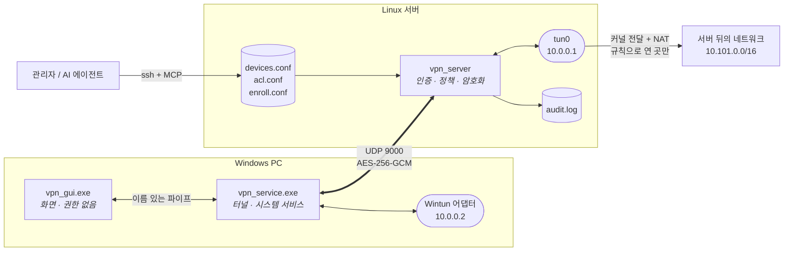
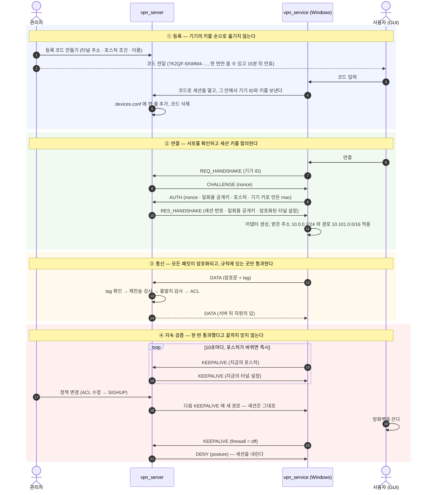
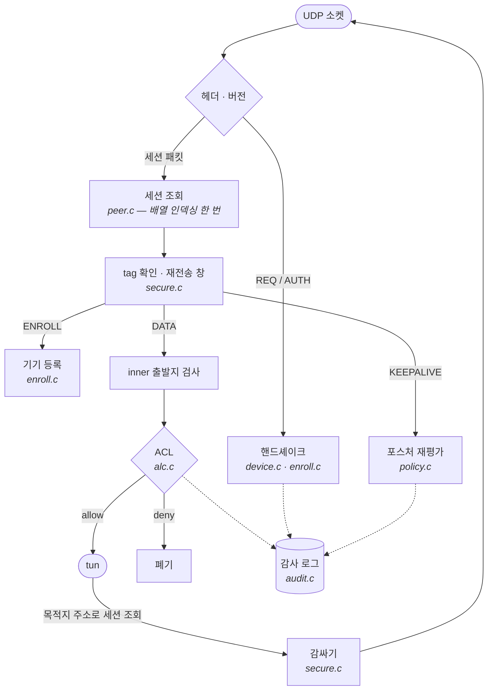
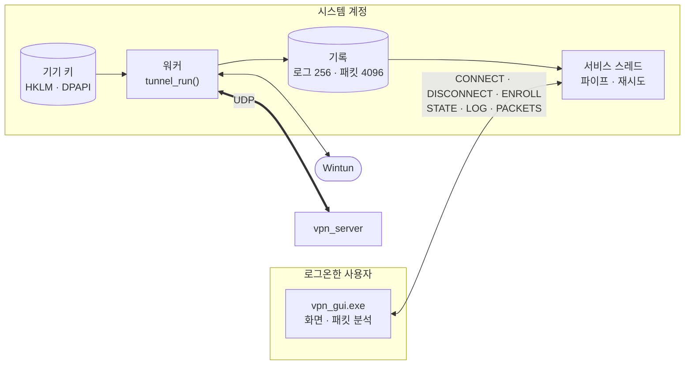

<div align="center">

# my_vpn

**C로 처음부터 만드는 ZTNA(Zero Trust Network Access) VPN**

등록된 기기만 들어오고, 들어온 뒤에도 계속 확인하고, 허락한 곳에만 닿는다.

[](https://github.com/k1msatgat/my_vpn/actions/workflows/ci.yml)


[한눈에 보기](#한눈에-보기) · [기기 하나가 붙기까지](#기기-하나가-붙기까지) · [빠른 시작](#빠른-시작) · [프로토콜](#프로토콜) · [보안 모델](#보안-모델) · [문서](#문서)

</div>

---

외부 VPN 라이브러리 없이 **패킷 포맷, 핸드셰이크, 세션 암호화, 접근 제어**를 직접 설계하고 구현한 L3 VPN입니다.
TUN 디바이스로 IP 패킷을 가로채 UDP로 터널링하는 데서 시작해, 상용 ZTNA 제품이 하는 일을 한 단계씩 쌓았습니다.

| | 전통적인 VPN | 이 프로젝트 |
|---|---|---|
| 누가 들어오는가 | 비밀번호나 인증서를 가진 사람 | **등록된 기기**. 기기마다 다른 키로 서버의 물음에 답해야 한다 |
| 한 번 들어오면 | 세션이 끝날 때까지 믿는다 | **10초마다 다시 본다.** 방화벽을 끄면 세션 중에도 끊긴다 |
| 어디까지 가는가 | 내부망 전체 | **적어서 연 곳만.** 규칙이 없으면 터널 대역 밖으로 나가지 못한다 |
| 설정은 누가 갖는가 | 클라이언트의 설정 파일 | **서버.** 터널 주소와 경로를 서버가 내려 주고, 정책을 고치면 붙어 있는 기기가 따라온다 |

> 학습 목적의 프로젝트입니다. 암호 프로토콜은 외부 검토를 받은 적이 없고, 프로덕션에서 쓰기 위한 보안 수준이 아닙니다.

## 한눈에 보기



| 조각 | 어디서 도는가 | 하는 일 |
|---|---|---|
| **`vpn_server`** | Linux, root | 기기를 인증하고, 세션마다 키를 합의하고, 패킷마다 ACL에 대 본 뒤 tun에 쓴다. epoll 단일 스레드 |
| **`vpn_service.exe`** | Windows, 시스템 서비스 | 터널을 맡는다. 가상 어댑터를 만들고, 서버가 준 주소와 경로를 넣고, 포스처를 보고한다 |
| **`vpn_gui.exe`** | Windows, 로그온한 사용자 | 서비스에 붙어 상태와 패킷을 보여 주고 연결 / 해제 / 등록을 시킨다. 닫아도 터널은 그대로다 |
| **`vpn_client.exe`** | Windows, 관리자 | 서비스 없이 스스로 터널을 여는 콘솔 클라이언트. 자동 테스트용 |
| **MCP 서버** | Linux, 일반 계정 | 관리자(또는 AI 에이전트)가 서버를 올리고 내리고, 등록 코드를 만들고, 정책을 바꾸고, 감사 로그를 본다 |

## 기기 하나가 붙기까지

이 프로젝트가 하는 일을 처음부터 끝까지 따라가면 이렇습니다.



1. **등록.** 관리자가 일회용 코드를 만들어 건넵니다. 기기는 그 코드로 서버와 암호화된 세션을 열고, 자기가 만든 ID와 키를 그 안에서 보냅니다. 키가 화면이나 클립보드를 거치지 않습니다.
2. **연결.** 기기는 서버가 방금 뽑은 nonce에 자기 키로 서명해 "내가 그 기기"임을 보이고, 양쪽은 이번에만 쓰는 ECDH 키로 세션 키를 합의합니다. 세션 키에는 기기 키가 섞여 있어서, 서버인 척하는 쪽은 클라이언트가 받아들일 답을 만들지 못합니다.
3. **설정.** 터널 주소와 "어디를 터널로 보낼 것인가"는 서버가 수락에 실어 줍니다. 클라이언트에는 서버 주소만 적습니다.
4. **통신.** 세션의 모든 패킷은 AES-256-GCM으로 감싸입니다. 서버는 tag가 맞는 패킷만 열고, ACL이 허용한 목적지로 갈 때만 tun에 씁니다.
5. **지속 검증.** 기기는 10초마다 지금의 포스처(OS 빌드, 방화벽, 백신)를 다시 보고합니다. 정책에 못 미치면 서버가 세션을 내립니다. 관리자가 정책을 고치면 붙어 있는 기기의 경로가 다음 보고 주기에 따라 바뀝니다.

## 기능

<table>
<tr><th width="22%">영역</th><th>내용</th></tr>
<tr><td><b>터널</b></td><td>
TUN 기반 L3 터널 (IPv4) · 직접 설계한 16B 헤더와 UDP 캡슐화 · epoll 단일 스레드 이벤트 루프 · 헤드룸 버퍼로 송신 경로에서 복사 없음 · 추측하기 어려운 32bit 세션 번호와 O(1) 조회 · keepalive, 세션 만료, 자동 재핸드셰이크
</td></tr>
<tr><td><b>신원</b></td><td>
기기 인증 (기기별 키, 챌린지-응답, HMAC-SHA256) · <b>등록 코드</b> — 일회용 코드로 기기가 자기 키를 암호화된 세션 안에서 서버에 올린다 · 서버도 확인된다 (세션 키에 기기 키가 들어간다)
</td></tr>
<tr><td><b>암호화</b></td><td>
핸드셰이크마다 일회용 ECDH(P-256) → HKDF → 방향별 AES-256-GCM 키 · 지난 세션은 기기 키가 새도 풀리지 않는다 · <code>counter</code>를 nonce로, 64개 폭의 창으로 재전송 차단 · 알고리즘은 OpenSSL / Windows CNG, 그 위의 프로토콜 코드는 양쪽이 같은 파일
</td></tr>
<tr><td><b>정책</b></td><td>
ACL (<code>src / dst / proto / dport</code>, first-match, 기본 거부) · <b>포스처 기반 접근 제어</b> — 기기별 조건과 ACL 규칙별 조건 · <b>지속 검증</b> — keepalive마다 다시 평가 · 서버가 터널 주소와 경로를 내려 준다 (경로는 ACL에서 뽑는다) · <code>SIGHUP</code>으로 세션을 끊지 않고 정책 변경
</td></tr>
<tr><td><b>전달</b></td><td>
서버 뒤의 네트워크로 전달 + NAT (nftables) · 규칙이 없으면 터널 대역 안까지만 · 반대 방향은 안에서 시작한 연결의 답만
</td></tr>
<tr><td><b>운영</b></td><td>
<b>감사 로그</b> — 누가 언제 들어와 어디에 닿았고 왜 거절됐는지를 JSON 한 줄씩 · 읽기 전용 상태 소켓 · systemd 서비스 · <b>MCP 서버</b> — 도구 18개로 서버 제어, 등록 코드 발급, 정책 변경, 로그 조회
</td></tr>
<tr><td><b>Windows</b></td><td>
Wintun 가상 어댑터 · <b>서비스 + GUI 분리</b> — 터널은 시스템 서비스가, GUI는 권한 없이 파이프로 조종 · 포스처 수집 (OS 빌드, 방화벽, 백신) · 패킷 분석 화면 (가상 리스트, 필드별 디코드, 폐기 사유 집계) · 기기 키는 시스템 계정의 DPAPI로 보관
</td></tr>
</table>

## 빠른 시작

### 서버 (Linux)

```bash
make                                     # gcc, OpenSSL 3 개발 헤더 필요
mcp/install.sh                           # systemd 서비스 + MCP 서버로 설치 (Node.js 18+)
sudo systemctl start my_vpn
```

설치하지 않고 직접 띄우려면:

```bash
sudo ./server/bin/vpn_server -e enroll.conf -a audit.log 9000 devices.conf acl.conf &
sudo ip addr add 10.0.0.1/24 dev tun0 && sudo ip link set tun0 mtu 1400 up
```

| 옵션 | 뜻 |
|---|---|
| `<port> <device-file> [acl-file]` | 듣는 포트, 기기 목록(필수), ACL(없으면 터널 대역 안까지만) |
| `-e <file>` | 등록 코드의 대기 목록. 주면 서버가 코드로 온 기기를 기기 목록에 직접 올린다 |
| `-a <file>` | 감사 로그 |
| `-s <path>` | 상태 소켓 |
| `-n <prefix>` `-m <mtu>` | 터널 대역의 prefix 길이와 MTU (기본 24, 1400). 클라이언트에 그대로 내려간다 |

### 기기 등록과 연결 (Windows)

```
:: 1. 빌드: Visual Studio 2022 로 windows\my_vpn.sln (x64). Wintun 을 windows\third_party 에 풀어 둔다
:: 2. 서비스 설치 — 한 번만, 관리자 명령 프롬프트
vpn_service.exe install

:: 3. GUI 실행 (권한 필요 없음) → 서버 주소 입력 → 포스처 탭의 [기기 등록...] 에 코드 입력 → [연결]
vpn_gui.exe
```

등록 코드는 서버에서 MCP의 `enroll_create`로 만듭니다. AI 클라이언트에 MCP를 붙였다면 이렇게 됩니다.

```
> 새 노트북 하나 등록할 수 있게 해 줘. 방화벽은 켜져 있어야 해.
enroll_create { label: "laptop-kim", requirements: { firewall: true } }
  → code: "FQXRX-GBGA5-CH8K3-3AEZG-N82GW", tunnel_ip: "10.0.0.2"   (15분 뒤 만료)

> 그 기기가 사내망 10.101.0.0/16 에 HTTPS 로만 가게 해 줘.
acl_set { rules: [{ src: "10.0.0.2", dst: "10.101.0.0/16", proto: "tcp", dport: "443", action: "allow" }] }
  → 붙어 있는 기기에 10초 안에 경로 10.101.0.0/16 이 내려간다

> 어제 누가 접속했고 어디에 갔어?
audit_log { since_seconds: 86400 }
```

GUI 없이 확인하려면 `vpn_service.exe ctl watch | enroll | connect | disconnect`, 서비스 없이는 `vpn_client.exe`를 씁니다.
자세한 절차는 [docs/linux.md](docs/linux.md), [docs/mcp.md](docs/mcp.md), [windows/README.md](windows/README.md)에 있습니다.

## 구조

### 서버



**열리지 않은 패킷은 세션의 어떤 상태도 바꾸지 못합니다.** 재전송 창에 표시하는 것, 클라이언트의 외부 주소를 갱신하는 것, 세션을 내리는 것 모두 tag를 확인한 뒤에 합니다. 위조 패킷 하나로 남의 세션을 끊거나 주소를 돌려놓을 수 없습니다.

| 파일 | 관리자가 고치는 것 | 서버가 하는 일 |
|---|---|---|
| `devices.conf` | 기기 ID, 키, 터널 주소, 포스처 조건 | 여기 있는 기기만 받는다. 등록 코드로 온 기기는 서버가 직접 한 줄을 더한다 |
| `acl.conf` | 누가 어디로 갈 수 있는가 (+ 규칙별 포스처 조건) | 패킷마다 대 보고, `allow`의 목적지 대역을 그 기기의 경로로 내려 준다 |
| `enroll.conf` | (MCP가 관리) 발급한 등록 코드에서 뽑은 임시 신원 | 그 코드로 온 기기를 받고, 쓰인 줄을 지운다 |
| `audit.log` | — | 세션의 시작과 끝, 거절, 목적지별 접근, 정책 변경을 한 줄씩 남긴다 |

`kill -HUP`(또는 MCP의 도구)으로 세션을 끊지 않고 다시 읽습니다. 파일이 깨져 있으면 이전 것을 그대로 씁니다.

### 클라이언트 (Windows)



- **GUI를 닫아도 터널은 그대로입니다.** 다시 켜면 열려 있는 터널에 붙고, 그동안 쌓인 기록부터 받습니다.
- **GUI는 권한 없이 뜹니다.** 어댑터를 만들고 경로를 넣는 일은 서비스만 합니다. 기기의 키도 서비스만 읽습니다.
- **워커는 파이프에 직접 쓰지 않습니다.** 기록에 쌓기만 하고 서비스 스레드가 내보냅니다. GUI가 멈춰도 터널을 나르는 스레드는 멈추지 않습니다.
- **터널이 내려가도 연결을 원한 상태면 15초 뒤에 다시 올립니다.** 재부팅하면 서비스가 이어서 연결합니다.

### 서버와 클라이언트가 함께 쓰는 코드

`lib/common`은 Linux 서버와 Windows 클라이언트가 **같은 소스를 빌드**합니다.

| 파일 | 내용 |
|---|---|
| `proto.{h,c}` | 와이어 헤더, 메시지 종류, 포스처 보고와 터널 설정의 직렬화 |
| `secure.{h,c}` | 세션 키 유도, 패킷 감싸기 / 풀기, 재전송 창, 등록 코드에서 임시 신원 뽑기, selftest 벡터 |
| `crypt.h` | 암호 도구의 선언. Linux 쪽은 OpenSSL(`lib/common/src/crypt_openssl.c`), Windows는 CNG(`windows/core/crypt.c`)가 채운다 |

키를 어떻게 뽑고 패킷을 어떻게 감싸는지가 양쪽에 따로 적혀 있으면, 한쪽만 고친 순간 서로의 패킷을 열지 못합니다. 그래서 OS별로 갈라지는 것은 알고리즘 호출뿐이고, 양쪽 `selftest`가 같은 표준 벡터(FIPS 180-4, RFC 4231, RFC 5869, GCM 명세, RFC 5903)를 통과하는 것이 서로 통한다는 근거입니다.

## 프로토콜

### 패킷의 모양

모든 UDP 페이로드는 `msg_header`로 시작합니다. 세션이 열린 뒤의 패킷은 종류와 관계없이 같은 모양입니다.

```
 0        1        2                 4                                   8
 +--------+--------+-----------------+-----------------------------------+
 | version|  type  |    reserved     |         session_idx (BE)          |  msg_header  (8B)  ┐ 암호화하지 않지만
 +--------+--------+-----------------+-----------------------------------+                    │ tag 가 함께 덮는다
 |                         counter (BE, 64bit)                           |  data_header (8B)  ┘
 +-----------------------------------------------------------------------+
 |                  암호문 (AES-256-GCM) ...                             |
 +-----------------------------------------------------------------------+
 |                         tag (16B)                                     |
 +-----------------------------------------------------------------------+
```

| type | 값 | 내용 |
|---|---|---|
| `REQ_HANDSHAKE` | 1 | 기기 ID (16B) |
| `RES_HANDSHAKE` | 2 | 세션 번호(헤더) + 서버의 일회용 공개키 (64B) + 암호화된 터널 설정 + tag |
| `DATA` | 3 | 세션 패킷. 암호문 = inner IPv4 패킷 |
| `KEEPALIVE` | 4 | 세션 패킷. C→S: 포스처 (8B) / S→C: 지금의 터널 설정 |
| `CHALLENGE` | 5 | nonce (16B) |
| `AUTH` | 6 | 기기 ID + nonce + 클라이언트의 일회용 공개키 (64B) + 포스처 (8B) + mac (32B) |
| `DENY` | 7 | 핸드셰이크 중: 사유 (1B) + mac (32B) / 세션 중: 세션 패킷, 암호문 = 사유 |
| `ENROLL` | 8 | 세션 패킷, 등록 코드로 연 세션에서만. C→S: 기기 ID + 키 / S→C: 결과 (1B) |

### 세션 키

```
secret = ECDH(이번 핸드셰이크의 일회용 P-256 키 쌍)
prk    = HKDF-Extract(salt = 기기 키, ikm = secret)
keys   = HKDF-Expand(prk, "my_vpn v4 session" | SHA-256(AUTH 패킷 | RES 의 헤더와 pub_s), 96B)
       = C→S 키 | S→C 키 | RES_HANDSHAKE 키
```

| 세션 키에 들어가는 것 | 그래서 |
|---|---|
| **기기 키** | 그 키를 모르는 쪽은 사이에 끼어 자기 일회용 키를 내밀어도 같은 세션 키에 닿지 못한다. 서버에 인증서를 두지 않아도 `RES_HANDSHAKE`의 tag가 맞았다는 것이 "상대가 이 기기의 키를 아는 서버"라는 증명이다 |
| **일회용 ECDH** | 기기 키가 나중에 새도 녹화해 둔 트래픽은 풀리지 않는다. 서버의 기기 목록에는 모든 기기의 키가 있어서, 이것이 없으면 서버가 한 번 뚫리는 날 지난 세션이 전부 풀린다 |
| **주고받은 패킷의 해시** | 도중에 한 바이트라도 바뀌었으면 양쪽의 키가 달라져 첫 패킷부터 열리지 않는다 |
| **방향마다 다른 키** | 양쪽이 `counter`를 0부터 세도 같은 (키, nonce)가 생기지 않고, 보낸 패킷을 되돌려 보내도 열리지 않는다 |

<details>
<summary><b>핸드셰이크의 세부</b> — 거절의 사유, 검사 순서, 방해에 대한 방어</summary>

<br/>

| 사유 | 값 | 뜻 |
|---|---|---|
| `DENY_UNKNOWN_DEVICE` | 1 | 기기 목록에 없는 ID (또는 쓸 수 없는 등록 코드) |
| `DENY_BAD_AUTH` | 2 | nonce가 다르거나 만료됐거나 mac이 틀림 |
| `DENY_TUN_IP` | 3 | (버전 3까지) 지금은 터널 IP를 서버가 내려 주므로 보내지 않음 |
| `DENY_POSTURE` | 4 | 인증은 됐지만 포스처가 그 기기의 정책에 못 미침 |

- **챌린지-응답**이라 키 자체는 와이어에 나오지 않습니다. nonce는 1회용이고 5초 뒤 만료되며, 서명이 맞는 `AUTH`를 받는 순간 버립니다.
- **확인되지 않은 패킷은 진행 중인 핸드셰이크를 건드리지 못합니다.** 살아 있는 nonce가 있는 동안 다시 온 `REQ`에는 같은 nonce를 내주고, 서명이 틀린 `AUTH`는 nonce를 버리지 않습니다. 기기 ID만 아는 제3자가 진짜 기기의 핸드셰이크를 깨뜨릴 수 없습니다.
- **검사 순서**는 기기 → nonce / mac → 포스처입니다. 키를 가졌다는 것을 확인하기 전에는 구체적인 거절 이유를 알려 주지 않고, 키 합의(비싼 계산)도 그 뒤에 합니다.
- **포스처와 일회용 공개키는 mac의 범위 안**이라 전달 도중에 "방화벽 꺼짐"을 "켜짐"으로 고치거나 공개키를 바꿔 끼울 수 없습니다.
- 클라이언트는 `AUTH`를 보내기 전에 온 수락과 **tag가 맞지 않는 수락을 받지 않습니다.**
- **거절을 믿어도 되는가.** 인증 뒤의 거절(포스처)에는 기기 키로 만든 mac이 붙습니다. 그 전의 거절은 서버가 상대의 키를 확인하지 못한 상태라 mac이 없고, 클라이언트는 이런 거절을 곧바로 믿지 않고 진짜 서버의 답을 끝까지 기다린 뒤 다른 답이 없을 때에만 받아들입니다. 세션 중의 거절은 세션 키로 감쌉니다.
- 새로 인증하면 새 세션입니다. 세션 번호도, 키도, counter도 새로 시작합니다.

</details>

<details>
<summary><b>터널 설정</b> — 서버가 주소와 경로를 내려 주는 방식</summary>

<br/>

```
tun_ip(4) | prefix_len(1) | n_routes(1) | mtu(2) | n_routes x ( addr(4) | prefix_len(1) )
```

| 값 | 어디서 오는가 |
|---|---|
| 터널 주소 | 기기 목록에 그 기기 앞으로 적힌 주소 |
| 대역의 prefix, MTU | 서버를 띄울 때의 `-n` / `-m` |
| 경로 | ACL에서 그 기기의 터널 주소가 출발지에 걸리는 `allow` 규칙들의 목적지 대역 |

- **경로는 ACL에서 뽑습니다.** 어디로 갈 수 있는지는 이미 ACL이 말하고 있습니다. 경로 목록을 따로 두면 둘이 어긋납니다 — 경로는 있는데 규칙이 없어 터널로 들어간 패킷이 버려지거나, 규칙은 있는데 경로가 없어 터널로 가지도 않습니다.
- **빼는 것**: `deny` 규칙, 터널 대역 안의 목적지, 목적지가 `any`인 규칙. 마지막은 모든 트래픽을 터널로 보내라는 뜻이 되는데, 접근시킬 대역은 적어서 엽니다.
- **`RES_HANDSHAKE`와 서버의 keepalive 응답에 통째로 실립니다.** 클라이언트는 받은 것과 지금 적용한 것을 비교하기만 하면 됩니다. 바뀐 것만 따로 알리는 메시지를 두면 그 한 통이 사라졌을 때를 위한 확인과 재전송이 필요해집니다.
- **클라이언트는 달라진 부분만 고칩니다.** 통째로 지우고 다시 넣으면 바뀌지 않은 경로까지 잠깐 사라집니다. 터널 주소가 바뀐 경우만 다시 핸드셰이크합니다.
- **클라이언트는 받은 경로를 그대로 믿지 않습니다.** `/0`과 서버 자신의 주소를 덮는 대역은 넣지 않습니다. 뒤의 것을 넣으면 터널 패킷을 싣고 가야 할 길이 터널 자신이 됩니다.

</details>

<details>
<summary><b>등록 코드</b> — 새 핸드셰이크를 만들지 않은 이유</summary>

<br/>

```
id  = HMAC-SHA256("my_vpn enroll id",  코드) 의 앞 16B     서버가 코드를 찾는 이름표
key = HMAC-SHA256("my_vpn enroll key", 코드)               코드를 아는 쪽만 만드는 비밀
```

코드에서 임시 신원을 뽑아 **평소의 핸드셰이크를 그대로 돕니다.** 그러면 이미 있는 것이 전부 따라옵니다 — 코드를 모르는 쪽은 세션을 열지 못하고, 서버인 척하는 쪽은 수락을 만들지 못하고, 기기의 진짜 키는 그 세션의 키로 감싸여 가므로 코드를 나중에 알게 된 사람도 녹화해 둔 등록에서 키를 꺼내지 못합니다. 새로 생긴 것은 `ENROLL` 메시지 하나입니다.

- 코드는 0-9와 헷갈리는 글자(I L O U)를 뺀 대문자 25자, 125비트입니다. 소문자, 줄표, O와 0을 섞어 적어도 같은 코드로 읽습니다.
- **한 번 쓰면 지워지고, 쓰지 않아도 만료됩니다.**
- **등록용 세션으로는 등록 말고 아무것도 하지 못합니다.** 터널 패킷도 keepalive도 받지 않습니다.
- **기기가 정할 수 있는 것은 자기 신원뿐입니다.** 터널 주소, 포스처 조건, 이름은 관리자가 코드를 만들 때 정한 것이 그대로 적힙니다.
- 기기는 **서버가 받아 준 뒤에** 신원을 저장합니다. 먼저 저장하면 서버에 닿지 못했을 때 예전 신원만 잃습니다.

</details>

<details>
<summary><b>keepalive와 세션의 수명</b></summary>

<br/>

| 상수 (`proto.h`) | 값 | 의미 |
|---|---|---|
| `KEEPALIVE_INTERVAL_SEC` | 10 | 클라이언트의 keepalive(포스처 보고) 주기 |
| `SERVER_TIMEOUT_SEC` | 30 | 클라이언트가 이 시간 동안 서버에서 아무것도 받지 못하면 재핸드셰이크 |
| `SESSION_TIMEOUT_SEC` | 60 | 서버가 이 시간 동안 수신이 없는 세션을 만료 |

- keepalive는 NAT 매핑 유지, 생존 확인, **포스처 재보고**, **터널 설정 갱신**을 겸합니다.
- **데이터는 순서가 바뀌어도 받고, 포스처 보고는 순서대로만 받습니다.** 보고는 "지금의 상태"라서, 방화벽이 켜져 있던 때의 보고를 길목에서 붙잡아 두었다가 끈 뒤에 풀어 놓는 것을 막아야 합니다.
- 거절된 클라이언트는 터널을 닫지 않고 통과만 막은 채, 포스처가 바뀌면 바로, 그렇지 않아도 30초마다 다시 핸드셰이크합니다. 닫아 버리면 사용자가 방화벽을 다시 켰을 때 스스로 돌아올 수 없습니다.
- 서버는 세션이 마지막으로 보고한 포스처를 기억해 두고, 포스처 조건이 걸린 ACL 규칙을 그 값으로 판정합니다. 기기 정책은 통과하지만 규칙의 조건에는 못 미치면 세션은 유지되고 그 목적지만 닫힙니다.

**세션 번호**

```
 31                                   8 7          0
 +-------------------------------------+------------+
 |        random (getrandom, 24bit)    | slot (8bit)|
 +-------------------------------------+------------+
```

하위 8비트가 피어 테이블의 자리라 서버는 배열 인덱싱 한 번으로 세션을 찾습니다. 상위 24비트 난수 덕분에 같은 자리를 다시 써도 이전 세션 번호는 무효입니다.

</details>

<details>
<summary><b>패킷이 지나는 길</b> — 송신, 수신, 검증 순서</summary>

<br/>

**서버의 송신 (TUN → UDP).** 버퍼의 앞 16바이트(헤더)와 뒤 16바이트(tag) 자리를 남기고 읽은 뒤, 읽은 자리에서 암호화합니다. 패킷을 옮기지 않습니다.

```
read(tun, buf + 16)     [ ........ 16B ........ ][ IP packet (n) ][ ... 16B ... ]
secure_seal(buf, n)     [ msg_hdr ][ counter   ][   암호문 (n)   ][    tag     ]
sendto(buf, n + 32)     └────────────────── 한 번에 전송 ──────────────────────┘
```

**서버의 수신 (UDP → TUN).**

1. 헤더 길이 / 프로토콜 버전
2. `REQ_HANDSHAKE` / `AUTH`면 핸드셰이크로
3. 세션 번호로 세션 조회
4. **세션 키로 열기** — tag가 맞지 않거나 이미 받은 `counter`면 여기서 버린다
5. 등록용 세션이면 `ENROLL`만 받는다
6. 종류별 분기 (keepalive → 포스처 재평가)
7. IPv4 형식 검사
8. inner 출발지가 그 세션의 터널 주소인가
9. ACL (규칙 파일이 없으면 터널 대역 안인가) — 결과를 감사 로그에
10. 모두 통과한 뒤에만 외부 주소와 `last_seen` 갱신, tun에 쓴다

**클라이언트의 수신.** 출발지가 서버인가 → 헤더 / 버전 → 내 세션 번호인가 → 세션 키로 열기 → 종류별 분기. "서버가 살아 있다"는 표시도 tag를 확인한 뒤에 합니다.

</details>

## 보안 모델

무엇을 막고, 무엇을 아직 막지 못하는지 적습니다.

| 위협 | 상태 | 어떻게 |
|---|---|---|
| 등록되지 않은 기기의 접속 | ✅ | 기기 목록에 있는 기기가 자기 키로 서버의 nonce에 서명해야 세션을 받는다 |
| 도청 | ✅ | 세션의 모든 패킷을 AES-256-GCM으로 암호화. 일회용 ECDH라 기기 키가 나중에 새도 지난 세션은 풀리지 않는다 |
| 패킷 주입 / 변조 | ✅ | 세션 키로 만든 tag가 맞아야 받는다. 헤더(종류, 세션 번호, `counter`)도 tag의 범위 안 |
| 재전송 | ✅ | `AUTH`는 1회용 nonce, 세션 패킷은 64개 폭의 창, 포스처 보고는 순서대로만 |
| 서버 위장 | ✅ | 세션 키에 기기 키가 들어가므로 그 키를 모르는 쪽은 클라이언트가 받아들일 수락을 만들지 못한다 |
| 위조 패킷으로 남의 세션 끊기 / 주소 돌리기 | ✅ | 세션 키로 열린 패킷만 세션의 상태를 바꾼다. 세션 중의 거절도 세션 키로 감싼다 |
| 핸드셰이크 방해 | ✅ | 살아 있는 nonce는 덮어쓰지 않고, 서명이 틀린 `AUTH`는 nonce를 버리지 않는다 |
| 세션 안에서 출발지 주소 위조 | ✅ | inner 출발지가 그 세션의 터널 주소와 다르면 버린다 |
| 정책 밖 목적지 접근 | ✅ | ACL 기본 거부. 규칙 파일이 없으면 터널 대역 안까지만 |
| 정책에 못 미치는 단말 | ✅ | 핸드셰이크와 매 keepalive에서 기기별 포스처 정책 평가, ACL 규칙별 포스처 조건 |
| 분실 / 폐기된 기기 | ✅ | 목록에서 지우면 다음 keepalive(10초 이내)에서 차단 |
| 사내에서 기기로 먼저 거는 연결 | ✅ | 전달 규칙이 안에서 시작한 연결의 답만 들인다 |
| 등록할 때 키가 새는 것 | ✅ | 기기의 키는 등록 코드로 연 세션의 키로 감싸여 간다. 코드는 일회용이고 만료된다 |
| 가짜 거절로 접속 방해 | ⚠️ | 인증 뒤의 거절은 확인한다. 인증 전의 거절은 확인할 수 없어 진짜 답을 끝까지 기다린다. 경로 위에서 패킷을 지울 수 있는 공격자는 여전히 막을 수 있다 |
| 가로챈 등록 코드 | ❌ | 만료 전의 코드를 가진 사람이 그 자리의 기기가 된다. 코드를 건네는 길이 신뢰의 근거이고, 누가 올라왔는지는 감사 로그에 남는다 |
| 메타데이터 노출 | ❌ | 누가(기기 ID) 언제 얼마나 주고받는지, 핸드셰이크의 포스처는 암호화되지 않는다 |
| 포스처 거짓 보고 | ❌ | 포스처는 클라이언트의 자기 보고다. 키를 가진 변조된 클라이언트는 거짓으로 보고할 수 있다 (막으려면 TPM 기반 원격 증명이 필요) |
| 사용자가 연결할 서버를 고르는 것 | ❌ | Windows에서 로그온한 일반 사용자가 서비스에 서버 주소를 줄 수 있다. 서버가 내려 주는 경로가 PC의 라우팅에 들어간다 |

<details>
<summary><b>알려진 한계</b></summary>

<br/>

- **암호 프로토콜은 검토를 받은 적이 없습니다.** 알고리즘은 OpenSSL과 CNG의 것이고 조립하는 방식(사전 공유 키 + 일회용 ECDH + HKDF + AEAD)도 널리 쓰이는 구조이지만, 이 조립 자체를 다른 사람이 분석한 적은 없습니다. 테스트가 보여 주는 것은 "의도한 대로 동작한다"까지입니다.
- **기기 키는 서버에 평문으로 있습니다.** 기기 목록 파일의 권한(600)에 기대며, 서버가 뚫리면 모든 기기의 키가 드러납니다. 공개키 방식이면 서버에는 공개키만 두면 됩니다.
- **세션 키를 도중에 바꾸지 않습니다.** 키는 다시 핸드셰이크할 때에만 바뀝니다.
- **기기만 인증합니다.** 그 기기를 누가 쓰고 있는지(사용자 로그인)는 보지 않습니다.
- **모든 트래픽을 터널로 보내는 구성은 없습니다.** 터널로 가는 것은 터널 대역과, ACL이 그 기기에 허용한 대역뿐입니다.
- **경로는 대역 단위입니다.** 도메인 이름으로 접근 대상을 정하는 방법은 없습니다.
- **ACL 규칙의 출발지는 터널 IP입니다.** 여러 기기를 역할로 묶어 쓰는 방법은 없습니다.
- **ACL이 막은 패킷은 클라이언트에게 알리지 않습니다.** 사용자에게는 타임아웃으로 보입니다.
- **재핸드셰이크는 블로킹입니다.** 응답을 최대 5초 기다리는 동안 터널 패킷은 처리되지 않습니다.
- **종료 통지가 없습니다.** 클라이언트가 종료해도 서버는 알지 못하고, 세션은 60초 뒤 만료로 정리됩니다.
- **IPv4만 터널링합니다.** 멀티캐스트 / 브로드캐스트도 통과하지 못합니다.
- **서버와 관리 도구가 같은 순간에 기기 목록을 고치는 경우를 잠그지 않았습니다.** 파일이 깨지지는 않지만 한쪽이 쓴 줄을 다른 쪽이 덮을 수 있습니다.

</details>

## 테스트

| 무엇을 | 어떻게 | 어디서 |
|---|---|---|
| Linux 서버 ↔ Linux 클라이언트 | `test/linux_e2e.sh` — netns 두 개에서 등록 → 연결 → ACL 차단 → 포스처 거부와 복구 | CI, 한 장비 |
| 서버의 프로토콜 | `sudo python3 test/auth_check.py` — 클라이언트인 척 UDP 패킷을 직접 만들어 보낸다. **176개.** 세션 키 유도와 패킷 형식을 서버의 코드를 거치지 않고 따로 구현했다 | CI, 서버 |
| 암호 도구 | `vpn_server selftest` / `vpn_client.exe selftest` — 양쪽이 같은 표준 벡터 20개 | CI |
| 빌드 | 서버 `-Wall -Wextra -Werror`, Windows `/W4` 경고 없음 (콘솔 + 서비스 + GUI) | CI |
| Windows 시나리오 | `windows\test\client.ps1 [idle\|restart]` — 연결, 유휴 중 keepalive, 서버 재시작 복구 | 실제 장비 |
| 서비스 | `vpn_service.exe ctl` — GUI 없이 등록 / 연결 / 상태 확인 | 실제 장비 |

`auth_check.py`가 보는 것: 모르는 기기와 틀린 키, `AUTH` 재전송과 만료된 nonce, 서명 뒤의 변조, 곡선 위에 없는 공개키, 핸드셰이크 방해, 포스처 정책의 경계값, 세션 패킷의 변조 / 재전송 / 다른 세션의 키, 순서가 바뀐 패킷과 창, 정책 다시 읽기, 규칙별 포스처, 터널 설정의 발급과 갱신, 규칙이 없을 때의 차단, 감사 로그, 등록 코드의 일회성과 등록용 세션의 제한.

## 프로젝트 구조

```
my_vpn/
├── lib/common/                # 서버와 Windows 클라이언트가 함께 빌드하는 코드
│   ├── include/{proto,crypt,secure}.h
│   └── src/{proto,secure}.c, crypt_openssl.c (Linux 쪽 암호 도구, OpenSSL)
├── server/                    # Linux 서버
│   └── src/
│       ├── server.c           # epoll 루프, 핸드셰이크, 데이터 경로
│       ├── peer.c             # 세션 표, 세션 번호, 만료
│       ├── device.c           # 등록된 기기 목록, 기기별 포스처 정책
│       ├── enroll.c           # 등록 코드의 대기 목록, 기기를 목록에 올리기
│       ├── alc.c              # ACL 파싱과 매칭, 규칙별 포스처 조건, 경로 뽑기
│       ├── policy.c           # 포스처 조건의 문법과 판정
│       ├── audit.c            # 감사 로그
│       └── status.c           # 상태 소켓
├── windows/                   # Windows 클라이언트 (Visual Studio 솔루션)
│   ├── core/                  # UI 에 의존하지 않는 순수 Win32 / C
│   │   ├── tunnel.{h,c}       #   Wintun + Winsock 터널 루프, 설정 적용, 등록
│   │   ├── posture.{h,c}      #   포스처 수집 (OS 빌드 / 방화벽 / 백신)
│   │   ├── device.{h,c}       #   기기 ID · 키 생성, DPAPI 보관
│   │   ├── crypt.c            #   암호 도구 (CNG)
│   │   ├── ipc.{h,c}          #   서비스와 GUI 사이의 메시지
│   │   └── vpn_remote.{h,c}   #   GUI 쪽: 파이프로 서비스에 붙는다
│   ├── svc/                   # vpn_service.exe — 터널을 맡는 서비스, 설치, ctl
│   ├── gui/                   # vpn_gui.exe — MFC, 직접 그리는 화면, 패킷 분석
│   ├── cli/                   # vpn_client.exe — 콘솔 클라이언트 (자동 테스트용)
│   └── test/client.ps1        # 시나리오 테스트
├── mcp/                       # Linux 서버를 제어하는 MCP 서버 (Node.js)
│   ├── server.js              #   도구 선언 (권한 없음)
│   ├── ctl.cjs                #   root 헬퍼 — 실제 일을 한다
│   └── my_vpn.service, service.sh, install.sh
├── client/                    # Linux 클라이언트 (프로토콜 v4: 등록, 인증, 세션 암호화, 포스처, 서버가 준 설정)
├── test/auth_check.py         # 서버의 프로토콜 검사
├── docs/{linux,mcp}.md
└── .github/workflows/ci.yml
```

## 문서

| 문서 | 내용 |
|---|---|
| **이 문서** | 전체 구조, 프로토콜, 보안 모델 |
| [docs/linux.md](docs/linux.md) | 서버 빌드와 실행, 기기 등록, ACL, 서버 뒤로 전달, 감사 로그, 상태 소켓 |
| [docs/mcp.md](docs/mcp.md) | MCP 서버 — 설치, 연결, 도구 |
| [windows/README.md](windows/README.md) | Windows 클라이언트 — 서비스와 GUI, Wintun, 패킷 분석 화면, 직접 그리는 UI |

## 로드맵

<details open>
<summary><b>한 것</b></summary>

<br/>

- [x] TUN 디바이스 + UDP 터널, 와이어 헤더, 핸드셰이크와 세션 번호
- [x] ACL (기본 거부), 위조 방어, keepalive와 세션 만료, 재핸드셰이크
- [x] Windows 클라이언트 — Wintun 콘솔 클라이언트, MFC GUI, 패킷 분석 화면
- [x] 기기 인증과 포스처 기반 정책, 지속 검증, 리소스별 포스처 조건
- [x] 정책 무중단 변경(`SIGHUP`), 핸드셰이크 방해 방어, 상태 소켓
- [x] MCP 서버, CI
- [x] **세션 암호화** — 일회용 ECDH + 기기 키로 세션 키, AES-256-GCM, 재전송 창
- [x] **서버가 내려 주는 터널 설정** — 주소 / MTU / ACL에서 뽑은 경로, keepalive로 갱신
- [x] **서버 뒤의 네트워크로 전달** — 규칙으로 연 곳만, NAT, 되돌아오는 답만
- [x] **감사 로그**
- [x] **등록 코드**
- [x] **Windows 서비스 + GUI 분리** — 이름 있는 파이프, 권한 없는 GUI, PC 단위의 키 보관

</details>

<details>
<summary><b>남은 것</b></summary>

<br/>

- [ ] 사용자 로그인 — 기기뿐 아니라 그 기기를 쓰는 사람까지
- [ ] 도메인 이름 기반 접근 — DNS 질의 가로채기
- [ ] 기기 그룹 — ACL 규칙의 출발지를 터널 IP가 아니라 역할로
- [ ] 세션 키 교체, 세션 최대 수명
- [ ] ACL 거부 통지 — 포스처 때문에 막힌 것을 사용자에게 알리기
- [ ] 비블로킹 재핸드셰이크, 종료 통지
- [ ] 포스처 항목 확대 (디스크 암호화, 화면 잠금, 패치 수준), TPM 기반 증명
- [ ] Windows — 서버 주소를 관리자만 정하게 하는 설정, 설치 프로그램
- [ ] 커넥터 (자원 쪽에서 밖으로 연결을 걸어 두는 방식), 관리 서버

</details>

## AI 사용 내역

이 프로젝트는 학습이 목적이므로, AI(Claude Code)를 어디에 썼는지 구분해서 밝힙니다.

| 구분 | 내용 |
|---|---|
| 직접 구현 | 와이어 프로토콜, 핸드셰이크, 피어 테이블, 위조 방어, keepalive, 세션 만료, 재핸드셰이크 등 초기 클라이언트 / 서버 기능 로직. ACL의 매칭 로직과 피어 테이블의 구조 |
| AI 리뷰 | 위 구현의 diff를 AI에게 검토받고, 지적받은 버그는 직접 수정 |
| 방향은 직접, 구현은 AI | ZTNA로의 확장 범위와 순서, "터널을 돌리는 서비스 + 조종하는 GUI" 구조 |

<details>
<summary><b>AI가 작성한 부분의 목록</b></summary>

<br/>

| 내용 |
|---|
| `test/` 테스트 스크립트 전체 |
| `client.c`의 재핸드셰이크 로그, `do_handshake`의 `SO_RCVTIMEO` 원복과 `tx_counter` 리셋 (일부) |
| `windows/` Windows 클라이언트 전체 — `core/tunnel.c`(Wintun 터널 루프), `core/vpn_session.c`(워커 스레드 / 메시지 마셜링), `cli/`, `gui/`, Visual Studio 프로젝트 파일. Linux 클라이언트의 프로토콜 동작을 기준으로 작성 |
| `proto.h` / `proto.c` 분리 (기존 코드 이동) |
| Windows 유휴 시 비유니캐스트 송신이 keepalive를 억제해 불필요한 재핸드셰이크가 생기는 문제를 테스트로 재현하고 `windows/` 쪽을 수정 |
| ZTNA 확장의 Windows 쪽 — `core/posture.c`, `core/device.c`, `core/tunnel.c`의 인증 핸드셰이크와 지속 검증, GUI의 포스처 탭과 기기 등록 창 |
| ZTNA 확장의 서버 쪽 — `server/src/device.c`, `server.c`의 `handle_request` / `handle_auth` / `handle_keepalive` / `send_deny`와 SIGHUP 처리, `peer.c`의 `peer_drop`, `test/auth_check.py`. 목표 직무가 Windows 클라이언트라 서버 쪽 확장은 AI에게 맡겼고, 기존 서버 로직(피어 테이블, 데이터 경로, ACL)은 직접 구현한 것 그대로 |
| `proto.h` / `proto.c`의 인증 · 포스처 메시지 정의. 메시지 흐름은 AI가 제안하고 검토 후 채택 |
| 서버의 ZTNA 확장 (2차) — `policy.c`, `status.c`, `alc.c`의 다시 읽기와 규칙별 포스처 조건, `server.c`의 nonce 재사용과 상태 소켓, `peer.c`의 단조 시계와 세션별 카운터 |
| 세션 암호화 — `lib/common`의 `crypt.h` / `secure.{h,c}`, `server/src/crypt.c`(OpenSSL), `windows/core/crypt.c`(CNG), 핸드셰이크 / 데이터 / keepalive 경로를 세션 키로 감싸도록 고친 것. 키를 어떻게 뽑고 무엇을 tag로 덮을지는 AI가 제안 |
| 서버가 내려 주는 터널 설정 — `net_config`, `acl_routes`, `netcfg_apply` / `netcfg_refresh`, GUI의 터널 IP 칸을 입력에서 표시로. 경로를 ACL에서 뽑는 방식은 AI가 제안 |
| 서버 뒤의 네트워크로 전달 — 규칙 파일이 없을 때의 판정, `mcp/service.sh`의 `forward_up` / `forward-down` |
| 감사 로그 — `server/src/audit.c`, MCP `audit_log` 도구 |
| 등록 코드 — `server/src/enroll.c`, `handle_enroll`, `secure_enroll_identity`, `tunnel_enroll`, 콘솔과 GUI의 코드 입력, `mcp/ctl.cjs`의 `enroll_*`. 새 핸드셰이크를 만들지 않고 코드에서 임시 신원을 뽑는 방식은 AI가 제안 |
| 서비스와 GUI의 분리 — `windows/svc/main.c`, `core/ipc.{h,c}`, `core/vpn_remote.{h,c}`, GUI를 서비스에 붙도록 고친 것, `device.c`의 PC 단위 보관 |
| `mcp/` MCP 서버 전체 — `server.js`, `ctl.cjs`, systemd 유닛, 설치 스크립트, `docs/mcp.md` |
| GUI 재설계 — `gui/ui_theme.cpp`, `gui/ui_controls.cpp`, `MainDlg`의 배치와 그리기, `vpn_gui.rc`, 앱 아이콘 |
| `.github/workflows/ci.yml`, CI가 찾은 `posture.c`의 `wscapi.dll` 동적 로드 |
| 이 README |

</details>
